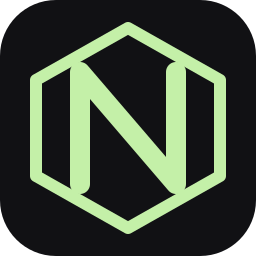

<div align="center">



# NovaFabric

**Replayable, verifiable evidence for AI agent runs.**

[](https://pypi.org/project/novafabric/)
[](https://www.python.org/)
[](https://github.com/MSKazemi/novafabric/actions/workflows/ci.yml)
[](https://scorecard.dev/viewer/?uri=github.com/MSKazemi/novafabric)
[](LICENSE)
[](https://arxiv.org/abs/2609.12582)

[Website](https://novafabric.ai) · [Documentation](https://novafabric.ai/docs/) · [Quick start](#quick-start) · [Paper](https://arxiv.org/abs/2609.12582) · [Discussions](https://github.com/MSKazemi/novafabric/discussions)

</div>

---

**NovaFabric is open-source, self-hosted replay and evidence infrastructure for AI agents
and agentic systems.** It records each execution as a **Run Capsule**: a portable,
secret-scanned directory that you own. Capture needs no changes to your application
code. From a capsule you can **replay** the run, **diff** it against another run, trace
its **lineage**, and export a **signed Evidence Bundle** that an auditor can verify
without NovaFabric installed.

It runs from a laptop to Docker, Kubernetes and SLURM clusters, online or air-gapped,
with no accounts and no telemetry.

<p align="center">
  
</p>

<p align="center">
  ▶ <a href="https://youtu.be/uQatmJIJI68"><b>Watch the 7-minute demo</b></a>: capture, seal, verify, and two tamper attempts caught and named.
</p>

## Why NovaFabric

Observability tells you how a system is behaving **right now**. NovaFabric answers a
different question: **can you prove, replay and compare a run weeks or months later?**
Its unit of value is not a row in someone else's database. It is a folder on your own
filesystem that you can archive, share, seal with your own key, and read with no
server running.

| Capability | What you get | Maturity |
|---|---|---|
| **Zero-code capture** | `nova capture <command>` records OpenAI, Anthropic, MCP and HTTP-client calls; transparent proxies cover non-Python clients | works today |
| **Replay** | Five modes, from read-only forensic inspection to mocked re-execution against recorded responses | works today (`intervention` experimental) |
| **Diff and CI gate** | Align two runs call by call; `--assert-no-regressions` fails the build on behavioural change | works today |
| **Lineage** | Provenance and blast-radius queries; OpenLineage and W3C PROV export | works today |
| **Signed evidence** | DSSE-signed seals and a Merkle log (opt-in), plus Evidence Bundles anyone can verify with standard tools | works today |
| **Secret scanning** | Every capsule is scanned and carries a redaction proof; a capsule without one is invalid | works today |
| **Server mode, dashboard, cluster collector** | Multi-user REST API, OIDC/RBAC, web dashboard, HPC/Kubernetes collection | experimental |

## Quick start

### Install

```bash
pip install novafabric            # or: uv add novafabric
uv tool install novafabric        # or: pipx install novafabric — CLI only, isolated
```

NovaFabric requires **Python 3.12+**. Capture, validate, replay and diff need no extras.
To try it without installing anything, open the repository in
[GitHub Codespaces](https://codespaces.new/MSKazemi/novafabric).

<details>
<summary><b>Optional extras</b></summary>

| To… | Install |
|---|---|
| Browse runs in a local dashboard (`nova serve`) | `pip install 'novafabric[serve]'` |
| Aggregate across runs (`nova query`) | `pip install 'novafabric[query]'` |
| Run multi-user server mode | `pip install 'novafabric[server]'` |
| Export compliance documents | `pip install 'novafabric[compliance]'` |
| Sign with Sigstore | `pip install 'novafabric[sigstore]'` |

Quote the argument: most shells treat `[` and `]` as glob characters.
`nova doctor --check-extras` reports which extras are installed and prints the command
for any that are missing.

</details>

### Capture, inspect, compare

```bash
# 1. Capture any command. No code changes.
nova capture python my_agent.py
# ✓ Capsule written: ~/.novafabric/capsules/01HXAY7M5JZ8R7K4P9DPBYK2WX

# 2. Validate it against the capsule schema; a missing redaction proof fails.
nova validate 01HXAY7M5JZ8R7K4P9DPBYK2WX

# 3. Replay it read-only: no network, no subprocess, no API keys.
nova replay 01HXAY7M5JZ8R7K4P9DPBYK2WX --mode forensic

# 4. Capture again and diff the two runs. Gate CI on behavioural change.
nova diff 01HXAY7M5JZ8R7K4P9DPBYK2WX 01HXB3K2T7QW9F0M4ZRC8DNV6P --assert-no-regressions

# 5. Trace lineage.
nova lineage provenance 01HXAY7M5JZ8R7K4P9DPBYK2WX
```

Capsules are written on **success and on failure**: a crash is captured evidence, not
lost state. A replay writes a replay result (`replay_result.yaml`) under
`$NOVAFABRIC_HOME/replays/` (default `~/.novafabric/replays/`), not a new capsule. To compare behaviour, capture the run
again and diff the two capsules.

<details>
<summary><b>What is inside a capsule</b></summary>

```
~/.novafabric/capsules/01HXAY7M5JZ8R7K4P9DPBYK2WX/
  capsule.yaml          ← run manifest (id, status, timing, refs)
  trace.jsonl           ← execution spans
  model-calls.jsonl     ← LLM API calls (OpenTelemetry GenAI semantic conventions)
  tool-calls.jsonl      ← tool invocations
  assets.jsonl          ← registry assets the run consumed
  lineage.jsonl         ← lineage edges emitted by this run
  env.lock              ← environment snapshot
  redaction-proof.json  ← what the secret scan checked and redacted
  replay.yaml           ← replay policy
  inputs/               ← created empty (not populated by capture today)
  outputs/
    stdout.txt          ← only when the stream is non-empty
    stderr.txt
  .seal/                ← only when NovaSeal is configured (opt-in)
```

</details>

<details>
<summary><b>In-process capture with the SDK decorator</b></summary>

```python
from novafabric.sdk.agent import agent

@agent(name="research-agent", version="0.1.0", capsule_dir="capsules/")
def run():
    # OpenAI, Anthropic and httpx calls are captured automatically
    return client.chat.completions.create(...)

run()   # each call writes its own capsules/<run_id>/
```

Without `capsule_dir`, the decorator emits OpenTelemetry spans only and writes no capsule.

</details>

The [Getting Started guide](docs/getting-started.md) walks through the full path,
including signing and the asset registry.

## How it works

**Capture.** `nova capture` injects a loader into the child process that hooks the
OpenAI, Anthropic and MCP SDKs and the `httpx`, `requests`, `aiohttp` and `urllib3`
clients. It classifies provider traffic (including AWS Bedrock) and records each call
with OpenTelemetry GenAI fields. Hooks for SDKs that are not installed are skipped.
Clients that are not written in Python (Claude Code, Cursor, Node or Go agents) are
captured by two transparent proxies, `nova api-proxy` and `nova mcp-proxy`. Third-party
hooks plug in through the `novafabric.hooks` entry-point group.

**Redaction is a precondition.** Before a capsule is finalized, NovaFabric
secret-scans the event streams, the manifest, `env.lock` and every file under `inputs/`
and `outputs/` (18 API-key and token rules; PII masking is a separate opt-in). Detected
values are redacted in place, and a hash-chained `redaction-proof.json` records what was
checked. The scanner matches **known key formats**: a capsule is *secret-scanned*, not
guaranteed secret-free. See [what the scan does not catch](docs/faq.md#what-does-the-secret-scan-not-catch).

**Replay** has **five explicit, falsifiable modes**:

| Mode | What it does | Use for |
|---|---|---|
| `forensic` | Read-only inspection. No subprocess, no network | Audit, post-incident review |
| `mocked` | Re-runs a Python workload. Recorded OpenAI and Anthropic replies and MCP tool results are served from the capsule; other tools run live. Fails closed on any unmatched call | CI, regression testing |
| `semantic` | Scores how similar the recorded responses are. Does not re-execute or call a model | Consistency checks |
| `exact` | Checks whether the run is eligible for a byte-exact re-run, and why. Does not re-execute | Local, on-premises and compliance runs |
| `intervention` *(experimental)* | Mocked replay after substituting one captured model or tool event | Counterfactual root-cause analysis |

NovaFabric does **not** claim exact replay of remote LLM calls. See the
[replay support matrix](docs/architecture/replay-modes.md#support-matrix).

**Evidence.** Sealing is opt-in. Once you configure a signing key, each capsule is
signed (DSSE, ECDSA P-256), entered in a tamper-evident Merkle log, and optionally
timestamped (RFC 3161). `nova verify` checks it offline. `nova export-evidence` builds a
signed Evidence Bundle: a ZIP that can be verified with only `sha256sum` and an Ed25519
verifier, with **no NovaFabric runtime required**
([what the bundle contains](docs/architecture/sealing-and-verification.md#what-is-in-the-bundle)).

**Architecture.** There are exactly two top-level formats, the Run Capsule and the
Evidence Bundle. The capsule is the source of truth; the registry, metadata database
and lineage graph are derived, rebuildable indexes. Local mode uses SQLite and never
needs a server. Server mode (Postgres) is optional and additive. See the
[architecture overview](docs/architecture.md).

## When to use NovaFabric

**Use it to:**

- **Reproduce a run later**, for regression debugging or incident forensics.
- **Gate CI on agent behaviour** with `nova diff --assert-no-regressions`.
- **Produce portable evidence** of what a run did, for governance and audit.
- **Capture without code changes**, in your own environment, including air-gapped ones.

**Look elsewhere if you need:**

- A fully managed, hosted observability dashboard with zero operations.
- Real-time, multi-user analytics and alerting as a turnkey product (server mode and the
  dashboard are experimental).
- A compliance *certification*. NovaFabric produces evidence that supports compliance
  workflows; it does not certify anything.
- A frozen on-disk format today. Capsule and bundle formats are frozen at v1.0.

NovaFabric is framework-neutral: it records what LangGraph, AutoGen, CrewAI, DSPy or the
OpenAI Agents SDK do, and sits beside inference servers, never in the request path.

## How NovaFabric compares

| | **NovaFabric** | Self-hosted observability (Langfuse, Arize Phoenix) | Hosted SaaS (LangSmith, W&B, Helicone) |
|---|---|---|---|
| Deployment | Self-hosted CLI, server optional, **no account** | Self-hosted server and database | Managed cloud service |
| Primary artifact | Portable evidence **capsule** (a folder) | Trace row in a database | Trace row in a vendor cloud |
| Where data lives | **On your machine** | Your server | Vendor cloud |
| Replay of a run | **Five modes** | — | — |
| Run-to-run structural diff | **Yes** | Partial (evals) | Partial (evals) |
| Cryptographic provenance | **Yes**, opt-in: in-toto DSSE, Sigstore, RFC 3161 | — | — |
| Capture without code changes | **Yes**: SDK, wire-level, proxy | SDK instrumentation | SDK or proxy |
| Works fully offline | **Yes** | Self-hosted only | — |

The two categories are complementary. Observability platforms are stronger at live
cost and token analytics, alerting and prompt experimentation. NovaFabric emits
OpenTelemetry GenAI spans and OpenLineage events, so it can feed an existing stack
while keeping portable capsules for replay and audit. See the
[full comparison](docs/comparison.md), including where NovaFabric loses.

**Standards used:** [OpenTelemetry GenAI](https://opentelemetry.io/docs/specs/semconv/gen-ai/) ·
[MCP](https://modelcontextprotocol.io/) · [OpenLineage](https://openlineage.io/) ·
[in-toto](https://in-toto.io/) · [SLSA](https://slsa.dev/) · Sigstore ·
[RFC 3161](https://www.rfc-editor.org/rfc/rfc3161) · JSON Schema 2020-12 · OPA/Rego ·
W3C PROV · C2PA (experimental). Each claim is listed, with how to check it, in
[Standards and specifications](docs/standards-conformance.md).

## Status

**Beta: v0.106.1.**

- **Usable today:** local capture, replay, diff, lineage (SQLite), the trust layer
  (signing, secret scanning, redaction), the asset registry, policy and approval gates,
  and the standard evaluation suites.
- **Experimental:** server mode, the cluster-scale collector, the object capsule store,
  the dashboard, the at-scale lineage backends, and the feature cohorts shipped since
  v0.59.

The Run Capsule and Evidence Bundle formats are **not frozen** until the v1.0 schema
freeze; changes until then are additive. The [Roadmap](ROADMAP.md) gives per-feature
maturity labels, and the [Changelog](CHANGELOG.md) and [release notes](docs/releases/)
record what shipped when.

## FAQ

**Does NovaFabric send my data anywhere?**
No. Data stays on your machine in local mode, or on your own server in server mode.
There are no accounts and no telemetry, and the core features work fully offline.

**Do I have to change my code?**
No. `nova capture <command>` wraps any command. Non-Python clients are captured through
`nova api-proxy` and `nova mcp-proxy`.

**Is it free?**
Yes. NovaFabric is licensed under Apache-2.0, with no paid tier and no hosted service
required.

**Is it production-ready?**
The local toolkit is beta and usable today. Server mode, the dashboard and the cluster
components are experimental. See [Status](#status).

More answers, covering evaluation, troubleshooting and trust, are in the [FAQ](docs/faq.md).

## Documentation

| If you want to… | Read |
|---|---|
| Get started | [Getting Started](docs/getting-started.md) · [Concepts](docs/concepts.md) · [Tutorials](docs/tutorials/README.md) |
| Look up a command or API | [CLI reference](docs/cli-reference.md) · [Python API](docs/python-api.md) · [REST API](docs/api-reference.md) |
| Evaluate NovaFabric for a team | [For platform teams](docs/for-platform-teams.md) · [Support policy](docs/support-policy.md) · [Security policy](SECURITY.md) |
| Run it in production | [Operator guide](docs/operator-guide.md) · [Server deployment](docs/ops/server-deployment.md) · [Air-gapped install](docs/ops/air-gapped-install.md) |
| Make research reproducible | [For researchers](docs/for-researchers.md) · [Benchmarks](docs/benchmarks.md) |
| Support audit and compliance work | [Assurance cases](docs/assurance-cases.md) · [Trust surfaces](docs/trust-surfaces.md) · [Standards](docs/standards-conformance.md) |
| Understand the design | [Architecture](docs/architecture.md) · [Architecture decisions](docs/decisions.md) |
| Capture CI jobs | [GitHub Action](.github/actions/capture/README.md) |
| Write or speak about the project | [Press kit](docs/press-kit.md) |

## Contributing

Contributions are welcome. [CONTRIBUTING.md](CONTRIBUTING.md) takes you from clone to
pull request, and every [good first issue](https://github.com/MSKazemi/novafabric/labels/good%20first%20issue)
names the files involved and a definition of done.

```bash
git clone https://github.com/MSKazemi/novafabric.git && cd novafabric
uv sync --all-extras          # all extras are required for the full test suite
make test-fast                # parallel, no Docker required
make lint typecheck check-links
```

A [devcontainer](.devcontainer/devcontainer.json) is included for Codespaces and VS Code.

- **Translations.** The documentation is currently available in English only.
  Translations are credited exactly like code; the [translation guide](docs/i18n/README.md)
  explains what to translate, and [issue #73](https://github.com/MSKazemi/novafabric/issues/73)
  coordinates languages.
- **Design changes** follow the [RFC process](docs/governance/rfc-process.md).
- **Coding agents** should read [AGENTS.md](AGENTS.md).
- **Questions and show-and-tell** go to [GitHub Discussions](https://github.com/MSKazemi/novafabric/discussions).

See also: [Governance](GOVERNANCE.md) · [Contributors](CONTRIBUTORS.md) ·
[Adopters](ADOPTERS.md) · [Support](SUPPORT.md).

If NovaFabric is useful to you, a ⭐ helps others find it.

## Citation

If you use NovaFabric in research or tooling, please cite the paper,
[arXiv:2609.12582](https://arxiv.org/abs/2609.12582). Citation metadata is in
[`CITATION.cff`](CITATION.cff).

```bibtex
@misc{seyedkazemi2026novafabric,
  author        = {Seyedkazemi Ardebili, Mohsen},
  title         = {{NovaFabric}: Tamper-Evident, Replayable Evidence for Autonomous {AI} Agent Runs},
  year          = {2026},
  eprint        = {2609.12582},
  archivePrefix = {arXiv},
  primaryClass  = {cs.CR},
  url           = {https://arxiv.org/abs/2609.12582}
}
```

To cite a specific software release:

```bibtex
@software{novafabric,
  author  = {Seyedkazemi Ardebili, Mohsen},
  title   = {{NovaFabric}: replayable, verifiable execution evidence for {AI} agents},
  url     = {https://github.com/MSKazemi/novafabric},
  version = {0.106.1},
  license = {Apache-2.0}
}
```

## License

NovaFabric is licensed under the [Apache License 2.0](LICENSE).

Created and maintained by [Mohsen Seyedkazemi Ardebili](https://github.com/MSKazemi),
AI Platform & Agentic Systems Engineer and independent consultant.

<!-- legal-notice: start -->
### Legal notice and responsible use

The materials in this repository are made available without warranties to the extent permitted by applicable law. **Please read the [Disclaimer and Responsible-Use Notice](DISCLAIMER.md)** before relying on or deploying them. This notice does not change any existing software license or limit rights that cannot legally be waived.
<!-- legal-notice: end -->

<!-- risk-guidance: start -->
### Operational safety and limitations

Before connecting accounts, running automation, relying on consequential outputs, or using production systems, review [project-specific safety risks and pre-deployment checks](SAFETY.md). The checklist describes precautions to **verify**, not a certification that the software currently enforces every safeguard.
<!-- risk-guidance: end -->
