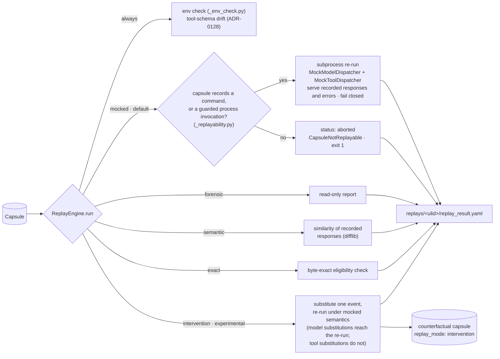

# Replay modes

[Architecture, as built](README.md) › Replay modes

`nova replay <capsule|run-id> --mode <mode>` (`cli/replay.py:replay_cmd`) loads a
capsule and passes it to `replay/_engine.py:ReplayEngine.run`. There are five
modes. Two of them, `mocked` and `intervention`, run the captured command again.
The other three read the capsule and execute nothing.

Every flag of these commands: [CLI reference — nova replay, diff and diagnose](../cli-reference.md#replay-commands-v03).

> **Release scope.** This page describes **v0.107.0**, the current release. The following
> shipped in v0.105.0: recorded MCP `call_tool` results served (ADR-0300), the fail-closed
> contract and `--permissive`, async / streamed / Responses API serving and live-network
> reporting (ADR-0304), replay of recorded model errors (**experimental**), the
> transport-record rule (ADR-0305), refusing capsules with no command to re-run,
> **experimental** serving of functions declared with `novafabric.capture.record.tool`
> (ADR-0306 slice 1), and — also **experimental** — `replay.yaml` `tool_overrides`
> enforced inside the replayed process, with `--permissive` needing the ladder flag before
> an unmatched MCP call runs live (ADR-0306 slice 2). In **v0.104.0** and earlier, `mocked`
> replay served recorded responses only for synchronous, non-streaming OpenAI chat
> completions and Anthropic messages, and every tool ran live; rows of the support matrix
> below that cite those ADRs do not apply to those versions. **New in v0.106.0**
> (**experimental**, ADR-0306 slice 4): MCP arguments matched after
> secret redaction, `record.tool` boundaries that called a model or tool served with their
> nested records consumed as covered, and the report-only tool-result echo check.
> Likewise **Google ADK tool serving** through the NovaFabric tool plugin (ADR-0306
> slice 3, **experimental**) is new in v0.106.0, as is **OpenAI Agents
> function-tool serving** through `wrap_tools`. **LangChain / LangGraph tool serving**
> through `novafabric.adapters.langchain_tools.wrap_tools` (ADR-0306 slice 3,
> **experimental**) is unreleased, as is re-running **framework-adapter capsules** from the
> process invocation they record (ADR-0306 open question 7, **experimental**).




## What every mode does first

Before it branches, `ReplayEngine.run`:

- loads `capsule.yaml`, `replay.yaml`, `env.lock`, `model-calls.jsonl` and
  `tool-calls.jsonl`;
- compares the recorded environment with the current one
  (`replay/_env_check.py:EnvironmentResolver`) and records any differences as
  `env_warnings`;
- re-validates each recorded tool call against its **current** declared schema
  (`capture/schema_validation.py:revalidate_tool_calls`, ADR-0128) and records
  any drift on the result in `forensic`, `semantic`, `exact` and `mocked` (the
  `intervention` path and `--dry-run` compute it but do not report it). Only
  `exact` mode refuses on drift.
- if any write-permitting ladder flag is passed (`--allow-mutating`,
  `--allow-external-side-effects`, `--allow-unknown-mutation`;
  `replay/_flags.py:ReplayFlags.permits_writes`), evaluates the
  `replay_mutating` policy, writes the decision to the audit log, and refuses
  the replay on a deny or a policy-engine error. *Changed in v0.106.0:*
  up to v0.105.0 only `--allow-mutating` triggered it.

Every mode writes `replay_result.yaml` (`replay/_result.py:write_replay_result`,
`schemas/replay-result.schema.json`) under `$NOVAFABRIC_HOME/replays/<ulid>/`
(`_paths.default_replays_dir()`, the directory `nova init` creates), or under
`-o <dir>`. Up to v0.106.0 the default was `./.novafabric/replays/` in the current
directory.

## The modes

| Mode | Executes the command? | What it does | Maturity |
|---|---|---|---|
| `mocked` (default) | **Yes**, in a subprocess, with a 600 s timeout | Re-runs `capsule.yaml:command` (a capsule with no command to re-run is refused up front — see [which capsules each mode accepts](#which-capsules-each-mode-accepts)). A `sitecustomize.py` installs `replay/_dispatcher.py:MockModelDispatcher` (recorded responses for the supported model surfaces — sync or async, streamed or not — one queue per API surface) and `MockToolDispatcher` (recorded MCP `ClientSession.call_tool` results, and — experimental, ADR-0306 — results of functions declared with `record.tool`, both matched one-to-one). **Fail-closed** on divergence; `--permissive` only reports. Tools on other surfaces run live; outbound connections are reported, not blocked — and in a strict replay a connection past loopback fails the replay (`unserved_network`, below). See [the mocked-replay contract](#the-mocked-replay-contract-adr-0300-adr-0304) and the [support matrix](#support-matrix). | works today (Python workloads, supported surfaces only) — the MCP, async/streamed and error serving shipped in v0.105.0 (error serving is experimental); see *Release scope* above |
| `forensic` | No | Read-only inspection. Reports call counts, environment warnings and schema drift. | works today |
| `semantic` | No | Scores how similar the recorded model responses within the capsule are to one another: the mean pairwise `difflib.SequenceMatcher` ratio, from 0.0 to 1.0. This is a **text** similarity, not a judgment of meaning, and no live model is called. | works today |
| `exact` | No | An **eligibility check** for byte-exact replay. It requires `env.lock` mode `deterministic` and a `gen_ai.request.seed` on every model call, and refuses if there is any tool-schema drift. Reports `exact_eligible` and `exact_reasons`. | works today |
| `intervention` | **Yes**, under mocked semantics | Needs `--intervention-file spec.yaml`. Substitutes one recorded model or tool event as the `InterventionSpec` describes (`replay/_intervention.py`), re-runs everything downstream with zero live model calls (a substituted **model** response reaches the re-run; a substituted **tool** result does not — tools run live, and the result records `intervention.substitution_delivered_to_workload: false`), and writes a minimal counterfactual capsule (`capsule.yaml` with `replay_mode: intervention` and `replay_of_run_id`, plus the call streams), so you can `nova diff` it against the original. | experimental (ADR-0086) |

## Which capsules each mode accepts

`mocked` and `intervention` re-run `capsule.yaml:command`, so they need a capsule that
records a real argv. `replay/_replayability.py:not_reexecutable_reason` is the one
check; it runs before anything is spawned. A capsule has **no command to re-run** when
its `capture_mode` is `sdk-decorator` (written inside a framework call by a framework
adapter in `novafabric.adapters` or by the `@agent` decorator (`novafabric.sdk.agent`); `command` is
a label such as `@langgraph:demo`) or `otel-import` (built from OpenTelemetry spans;
`command` is empty), or when `command` is empty or starts with `@`.

| Mode | `cli-wrapper` capsule (`nova capture`) | No command to re-run (`sdk-decorator`, `otel-import`, empty) |
|---|---|---|
| `forensic` | works | works |
| `semantic` | works | works |
| `exact` | eligibility report | eligibility report: always `exact_eligible: false`, with the reason in `exact_reasons` |
| `mocked` | re-runs the command — unless it records a model call replay cannot serve (below) | **refused** before spawning (an adapter capsule whose recorded process invocation passes every guard is re-run instead, below): `status: aborted`, `error.type: CapsuleNotReplayable` (`replay/_errors.py:CapsuleNotReplayableError`), exit 1; `--dry-run` prints the same `REFUSED:` message and also exits 1 |
| `intervention` | re-runs the command under mocked semantics | emits the counterfactual capsule **without** re-running; `intervention.downstream_reexecuted: false`, `downstream_not_reexecuted_reason` and `substitution_delivered_to_workload: false` say so |

**Adapter capsules that record their process invocation** (experimental, ADR-0306
open question 7, Option 1). Every framework adapter and the `@agent` decorator now also
record how their *process* was started, in the `process_invocation` facet
(`capture/process_invocation.py`): `argv` (the interpreter that ran, then the arguments
as given; the home directory as `~`), `entry_kind` (`script`, `module` for `-m`, `code`
for `-c`, or `interactive` / `stdin` / `unknown`), the entry file and its SHA-256, the
working directory, whether stdin was a terminal, the run's ordinal in its process, and
any loaded module that marks a harness host. `command` keeps the `@framework:name`
label and `capture_mode` stays `sdk-decorator`. `mocked` and `intervention` re-run such
a capsule from that invocation, in the recorded working directory and with stdin
closed, **only when every guard passes**; otherwise it is refused like any capsule
without a command, and `error.guard` names the guard:

| Guard (`error.guard`) | Refused when |
|---|---|
| `facet_malformed` | the facet does not match its shape |
| `entry_not_reproducible` | the process was a REPL, read its program from stdin, or its `sys.argv` did not match what it ran (rewritten argv, frozen app, a directory change before the adapter ran) |
| `long_lived_host` | the entry is a known host (`ipykernel_launcher`, `jupyter`, `ipython`, `pytest`, `uvicorn`, `gunicorn`, `hypercorn`, `streamlit`, `celery`), or a notebook kernel, pytest session, xdist worker or Streamlit app was loaded |
| `argv_redacted` | an argument was redacted as a secret at capture |
| `not_first_adapter_run` | the capsule is the second or later adapter run of its process |
| `entry_file_missing` / `entry_changed` / `entry_not_verifiable` | the entry file is not on this host, its SHA-256 differs from capture, or no digest was recorded |

In the re-run process the adapters write **no** capsule (the replay writes its own
replay capsule, ADR-0321); they report each run to the replay. A process that makes
more or fewer adapter runs than the capsule recorded diverges
(`adapter_run_count_mismatch`; `replay_contract.adapter_runs_expected` /
`adapter_runs_observed`). The fidelity verdict's `exit_code` check compares the
framework call's recorded outcome with the re-run call's, not the process exit code;
an adapter capsule records no process output, so `stdout_sha256` is not compared and
the verdict is at best `not_compared`. Tested end to end with real LangGraph
(`tests/replay/test_langgraph_adapter_replay_e2e.py`); the other adapters record the
facet and are covered by the guard tests only. Limits: model calls the process makes
outside the adapter's run are not in the capsule and diverge (fail closed); only the
entry file is digested, not the modules it imports; a script that starts a server
in-process is not recognised and is stopped by the 600 s timeout; a low-entropy
secret in an argument is not detected by the redaction pass (as for `nova capture`'s
argv). The working directory is applied to adapter capsules only — a `nova capture`
capsule still runs in the invoking shell's directory. An adapter capsule written
before this change has no facet and is refused with the same message as before.

**Model calls replay cannot serve** (works today, ADR-0319). Capture records an
HTTP call to any model-registry host as a model call — Ollama, the Hugging Face
`InferenceClient`, other providers' raw HTTP — with `gen_ai.system` set and no
response. `replay/_servability.py:classify` puts every record of
`model-calls.jsonl` in one class: **servable** (a surface in
`SERVED_SURFACES` serves it: a recorded response or a recorded SDK error),
**not servable** (a logical model call no surface serves, including a served
surface whose response was never recorded), or **transport** (an ADR-0305
transport record, ignored). A strict `mocked` replay of a capsule with any
not-servable call is **refused before spawning**: `status: aborted`,
`error.type: ModelSurfaceNotServable`
(`replay/_errors.py:ModelSurfaceNotServableError`) with
`error.model_calls_not_servable_by_system` (count and endpoint `host[:port]` per
`gen_ai.system`, never a path, query or credential), `model_calls_not_servable`,
exit 1. `--dry-run` prints the same `REFUSED:` message, lists each call as
`[LIVE] model call (<system>, <host>)`, and exits 1. `--permissive` runs it
(the call goes live if the workload makes it) and reports
`model_calls_not_servable`, `replay_contract.model_calls_not_servable_by_system`
and a `model_surface_not_servable` divergence, a warning that does not fail the
replay. Before ADR-0319 such a record was ignored and the replay reported
"model calls: 0 of 0 served" and `success` while the call ran live.
`intervention` does not apply this check.

## Replayability at capture time (experimental)

Every capsule written through the shared finalization path — `nova capture`, the
framework adapters, the `@agent` decorator, OpenTelemetry import — now carries
`replayability.json`: what a **strict `mocked` replay** of it would do, decided when
the capsule is written instead of when it is first replayed. It is computed by
`replay/_replayability_summary.py:assess` from the redacted streams, with the same
functions the replay engine and `--dry-run` use (`_servability.classify`, the tool
predicates of `_contract`, `_replayability.require_reexecution_plan`,
`PolicyEvaluator.unenforceable_overrides`), so it follows any change to those rules. A
test runs the dry run and the summary over the same capsules and requires the same
refusal, the same unservable-model-call count and the same per-tool decision.

| Field | Meaning |
|---|---|
| `replayable` | `full` — a strict replay would start and serve every recorded call; `partial` — it would refuse (an unservable surface) or start with calls it does not serve; `none` — the capsule cannot be re-run at all (`CapsuleNotReplayable`) |
| `strict_mocked` | `start` or `refuse` |
| `refusal` | the `error` a strict mocked replay records (`type`, `message`, and `guard` / `model_calls_not_servable_by_system` / `tool_calls_not_served_by_surface` as the replay writes them), or `null` |
| `reexecution` | `reexecutable`, `source` (`command` or `process_invocation`) and the refusing `guard` |
| `model_calls` / `tool_calls` | counts: `recorded`, `servable`, `not_servable`, plus `live` (model-host metadata calls), `observed_only` and `not_intercepted` (tools) |
| `reasons` | one entry per reason, in the order the replay checks them, each with `code`, `count`, `refuses_strict`, a `summary` and a `detail` |

Reason codes: `capsule_not_reexecutable` (with `guard`), `model_surface_not_servable`
(with `by_system`), `tool_surface_not_served` (LangChain tools observed but not passed
through `wrap_tools`; with `result_never_sent_to_a_model` listing the tools whose result
was not kept and never went back to a model — a run's last tool call — so the
model-request echo cannot recover it, ADR-0306 r3b), `tool_override_unenforceable` —
these four refuse a strict replay before anything runs — and `tool_result_not_servable`
(with `cause: result_never_sent_to_a_model` for that same case, `payload_not_recorded`
when payload capture was off otherwise, e.g. `record.tool` at the default `standard`
level, else `other`; a strict replay starts and refuses the call when it is made), `tool_not_intercepted` (a tool on a transport replay does not intercept; it runs
live), `model_metadata_call_live` (an Ollama `/api/tags`-style or Bedrock control-plane
request; it runs live).

`nova capture` prints one line from it after `Capsule written`, for example
`! replay: strict mocked replay would refuse -- 3 model calls not servable (mistral: 3
(api.mistral.ai)) (see nova replay --dry-run)`, and `nova capture --require-replayable`
exits `4` unless `replayable` is `full` (the workload runs and the capsule is written
first; see the [CLI reference](../cli-reference.md#nova-capture-cmd)).

Limits: the summary is a prediction by the version that captured the capsule — `nova
replay` never reads it and classifies the capsule again, so a later version that serves
more surfaces is not bound by it. It cannot predict calls the capture did not record
(an uninstrumented client, a non-Python child, raw sockets); those show up only at
replay, as reported network connections. A capsule written before this change has no
`replayability.json` (unknown); it replays exactly as before. Computing the summary
is fail-open: on an error the file is not written and the capture is not affected.

## The mocked-replay contract (ADR-0300, ADR-0304)

`replay/_contract.py` is the one place that decides what the dispatchers may
serve and how a replay is summarised; the engine and the in-process dispatchers
both use it.

**What is served.** A recorded model call is servable when it belongs to a
served API surface — OpenAI Chat Completions, the OpenAI Responses API (records
marked `extensions["io.novafabric.api_surface"]: "openai.responses"`), or
Anthropic Messages — its `status` is `success`, and it has at least one recorded
choice. Each surface has its own queue, in recorded order; a sync, async or
`stream=True` call to a surface takes the next record from that queue, and a
streamed call gets the record back as the chunk or event stream the SDK would
have produced (ADR-0304). (Every SDK call is also recorded by the `httpx` wire
hook, once per HTTP attempt, with no choices; since ADR-0305 those records are
marked `transport`, and they are never served or counted. See
[Model-call record roles](run-capsule.md#model-call-record-roles).)

**Recorded model errors are served too** (issue #16). When the captured call
raised — a rate limit, a 4xx, a 5xx after the SDK's own retries, a timeout or a
connection error — the SDK hook wrote one logical error record carrying
`extensions["io.novafabric.sdk_error"]`: the exception class, HTTP status,
message, parsed error body, request id, and the retry and rate-limit response
headers. That record holds its position in the surface's queue, and the replayed
call there **raises the same SDK exception class** (`openai.RateLimitError` with
`status_code == 429`, `body`, `request_id`, and a synthetic `response` carrying
the recorded status, headers and body), sync or async, streamed or not. Classes
come from an explicit allow-list per SDK (`replay/_model_errors.py:ALLOWED_SDK_ERRORS`:
the `APIStatusError` family, `APIConnectionError`, `APITimeoutError`), looked up
on the SDK package itself — never imported by a name read from the capsule. The
wire hook's record of each HTTP attempt is a transport record (ADR-0305) and is
never served, so a call the SDK retried twice and then completed is served as
the success it was; in a capsule captured before ADR-0305, the legacy fallback
identifies those attempts instead. A recorded error that cannot be rebuilt
faithfully — a class outside the allow-list, a missing status, a body too large
to have been recorded, or a capsule captured before the error detail was
recorded — is the divergence `recorded_error_unreconstructable`.

**Ollama `/api/chat` and `/api/generate`** (ADR-0320, **experimental**). There is no
SDK hook for Ollama: the `httpx` wire hook records these calls, and since ADR-0320
it records the response too — the text (`message.content` or `response`),
`message.tool_calls` as canonical `{id, name, arguments}` refs (`id` only when
Ollama sent one), the finish reason (`tool_calls` when the turn has tool calls,
`length` for `done_reason: length`, otherwise `stop`; the raw `done_reason` is
kept), `prompt_eval_count`/`eval_count` as usage, and the marker
`io.novafabric.api_surface: "ollama.chat"` / `"ollama.generate"`. A streamed
(NDJSON) body — the Ollama API's default, what `langchain_ollama` always uses and
the `ollama` SDK uses with `stream=True` — is never read ahead: the hook copies
the bytes as the workload reads them and writes the record when that read ends. A
body the workload closed before reading it to the end is flagged
`io.novafabric.stream_complete: false`. Because nothing sits above the wire for
these calls, the wire record is the logical call (ADR-0305). In a mocked replay
the dispatcher patches `HTTPTransport.handle_request` and
`AsyncHTTPTransport.handle_async_request` (`httpx`, and `httpx2` when installed):
a `POST` to `/api/chat` or `/api/generate` on a host the URL registry classifies
as Ollama (including `OLLAMA_BASE_URL` / `OLLAMA_HOST`, read at call time) or on
a host the capsule recorded an Ollama call to is answered from that endpoint's
queue, in recorded order, and never reaches the network. A streamed request gets
NDJSON in the recorded chunks, ending with the `done` object; a non-streamed one
gets one JSON object. An exhausted queue (`model_queue_exhausted`), a call to the
other endpoint than the one recorded (`provider_mismatch` / `order_mismatch`) and a
recorded failed call (`recorded_error_unreconstructable`) fail closed. A record
captured before ADR-0320 has no response and no marker: it is never served.
Other Ollama endpoints (`/api/embed`, `/api/tags`, `/api/show`, the
OpenAI-compatible `/v1/...` reached without the `openai` SDK) are generic wire calls
(below) in a capsule recorded since ADR-0324; in an older capsule they are not served
and run live. Not served back: the `context` token array of `/api/generate`, `logprobs`,
and fields Ollama sends inside a tool call beyond its name and arguments.

**Any other registry model host — generic wire** (ADR-0324, **experimental**). A call
to a host the URL registry classifies as a model provider (Mistral, Cohere, Together,
Replicate, Hugging Face Inference, Gemini REST once its host is in the registry, or an
OpenAI-compatible local server you add with a registry override) is served with no
provider-specific code, when it went through `httpx`/`httpx2` or `requests`, no SDK
call was open (an OpenAI/Anthropic SDK call is recorded and served by its SDK hook) and
no dedicated server claims it (Ollama chat/generate, Bedrock Converse). At capture the
wire hook keeps, besides the request it always kept: the marker
`io.novafabric.api_surface: "generic-wire"`; `io.novafabric.wire.request` — method,
path and a SHA-256 digest of the canonical query (sorted, credential parameters such as
`key`, `api_key`, `token`, `x-amz-*` removed) and body (JSON key-sorted, top-level
`request_id`/`timestamp`/`nonce` removed), never the body itself; and
`io.novafabric.wire.response` — the status, the allowlisted response headers
(`content-type`, `retry-after`, request ids, rate-limit headers; never `set-cookie`,
`location`, auth challenges or framing headers) and the body as UTF-8 text chunks in the
order the workload read them. A streamed body is copied as the workload reads it, never
read ahead, and the record is written when that read ends (closed early:
`complete: false`, the delivered chunks only). Bodies are stored as text so the
finalize-time secret scanner redacts them like every other value. They are stored at
every capture level, exactly like OpenAI responses; `NOVAFABRIC_CAPTURE_WIRE_RESPONSES=off`
stores none. Not recorded (the record says why in
`io.novafabric.response_not_recorded`, and a strict replay refuses it, ADR-0319): a
request that raised before a response, a streamed body with a `content-encoding`, a
body that is not UTF-8 text, a body over 8 MiB or 65 536 chunks.
In a mocked replay — only when the capsule holds such a record — the dispatcher
answers these requests at the `httpx`/`httpx2` transport and at `urllib3`
`HTTPConnectionPool.urlopen` (how `requests` sends), one record per request in recorded
order. The request must match the record: same method, same registry `gen_ai.system`
(not the literal `host:port`, so a local server on another port still matches), same
path and same canonical digest; headers are never compared, so a new token, request id
or signature still matches. A different request is the divergence
`wire_request_mismatch` (it names method, system and path, never the request text):
strict replay refuses the call and nothing reaches the network; `--permissive` runs it
live and counts it. The served response carries the recorded status, headers and
chunks — a recorded `429` that the client retried is served back, then the success —
and the client library parses them exactly as it parsed the network body. Served calls
count under the `generic-wire` queue.

**AWS Bedrock `Converse` and `ConverseStream`** (**experimental**). `boto3` sends
every Bedrock runtime call through `urllib3`, so the `urllib3` wire hook records it
(`gen_ai.system: aws.bedrock`), and it now records the response too: the text
blocks (concatenated), `toolUse` blocks as canonical `{id, name, arguments}` refs
(`id` = `toolUseId`), the finish reason from `stopReason` (`end_turn` and
`stop_sequence` → `stop`, `tool_use` → `tool_calls`, `max_tokens` → `length`,
guardrail and content-filter stops → `content_filter`; the raw value is kept),
`usage`, and the marker `io.novafabric.api_surface: "aws.bedrock.converse"` /
`"aws.bedrock.converse_stream"`. The request side gets `gen_ai.request.model`
from the URL (`/model/<modelId>/converse`, URL-decoded, e.g.
`qwen.qwen3-32b-v1:0`), `inferenceConfig` as the sampling attributes, the
`messages` verbatim (Bedrock content blocks), and `system` / `toolConfig` /
`additionalModelRequestFields` verbatim under `io.novafabric.bedrock.request`.
botocore reads the body itself, so the hook never does: it copies the bytes as
botocore reads them (at once for `Converse`, as the workload iterates for
`ConverseStream`) and writes the record when that read ends; a stream closed
early is flagged `io.novafabric.stream_complete: false`. The SigV4
`Authorization` and `X-Amz-*` request headers are never recorded. A host is
classified as Bedrock by the URL registry (`bedrock-runtime.*`) or, at call time,
by `AWS_ENDPOINT_URL_BEDROCK_RUNTIME` / `AWS_ENDPOINT_URL_BEDROCK` (botocore's
service-specific endpoint variables); a custom `endpoint_url` passed in code to
another host needs a registry override. In a mocked replay the dispatcher patches
`urllib3.connectionpool.HTTPConnectionPool.urlopen`: a `POST` to
`/model/<id>/converse` or `/converse-stream` on such a host, or on a host the
capsule recorded a Bedrock call to, is answered from that API's queue, in
recorded order, and never reaches the network; botocore parses the served bytes
with its own parser (an event stream for `ConverseStream`, re-encoded from the
recorded events). Serving is positional, so a request signed with other
credentials or at another time is served the same. A recorded HTTP error is
served back with its status and body: botocore raises the same `ClientError`, and
a throttle botocore retried at capture is retried the same way at replay,
reaching the recorded success. An exhausted queue, a `ConverseStream` call where
`Converse` was recorded (or the reverse) and a call that failed without a
response (the request raised, or the body failed part-way) fail closed; botocore
hands such a refusal to the workload wrapped in its own `HTTPClientError`, and
the divergence is in the replay result. The echo check reads Bedrock `toolResult`
blocks, so a tool result the replayed workload sends back that differs from the
recorded one is reported (report-only). `InvokeModel` (provider-specific bodies)
is recorded without a response and refused; control-plane calls (the `bedrock`
client, e.g. `ListFoundationModels`) run no model, so they are not refused and run
live. Replay still needs AWS credentials of some kind in the environment, because
botocore signs every request before it is sent (dummy values are enough); with
none, botocore's credential chain may contact the instance-metadata endpoint,
which runs live and is reported.

A recorded tool call is
servable when it is an MCP `tools/call` with a tool name; a call captured both by
the in-process MCP hook and by `nova mcp-proxy` counts once.

**Declared Python tools** (ADR-0306 slice 1, **experimental**). A function the
workload decorates with `novafabric.capture.record.tool` is a second intercepted
tool surface, `novafabric.capture.record.tool`. Under `nova capture` each call
writes one `tool-calls.jsonl` record with `transport: "python"` and the marker
`extensions["io.novafabric.tool_surface"]: "python.function"` (no schema change).
In a mocked replay, `MockToolDispatcher` registers a server with the façade, and
the decorator asks it **before the function body runs**. The record is served
only when capture marked it `io.novafabric.result_codec: "json-v1"`: arguments
and result were kept (capture level `forensic` or `air_gapped` —
`NOVA_CAPTURE_LEVEL`; at lower levels only digests are kept), every argument was
JSON-native (exclude others with `ignore=`), the result was JSON-native and at
most `NOVAFABRIC_TOOL_RESULT_MAX_BYTES` (default 1 MiB).

**Nested boundaries** (ADR-0306 slice 4, **experimental**, since v0.106.0). A
decorated function may itself call a model, an MCP tool or another decorated
function. Capture marks every record written inside it with
`io.novafabric.within_tool_call_id` and counts them on the boundary
(`io.novafabric.nested_records`). When replay serves the boundary, its body never
runs, so those calls are never requested: they are consumed as **covered** —
nested boundaries transitively — and the model queue skips their positions in
place, so the calls after the boundary still get their own recorded answers.
Covered records are counted (`model_calls_covered`, `tool_calls_covered`, and
`covered` per tool surface), never served and never left over. A nested call made
from a raw thread inherits no context and is not marked; its record stays in the
queue and a strict replay fails closed. Capsules captured by v0.105.0 marked such
a boundary not servable with a fixed reason; replay recognises that exact reason
and serves them without re-capture.
A recorded exception is raised again as the same class only when it is a builtin
`Exception` subclass; anything else is `ReplayRecordedToolError`. Results are
decoded as JSON only — never unpickled or imported by name.

**Google ADK tools** (ADR-0306 slice 3, **experimental**, since v0.106.0). A workload
that passes `novafabric.adapters.google_adk.make_tool_plugin()` **first** in its
ADK `Runner(plugins=[...])` gets a third intercepted surface,
`google.adk.tools.BaseTool`, built on the way ADK documents to skip a tool: a
plugin `before_tool_callback` that returns a value "will stop the tool execution
and return this response immediately" (google-adk 2.11.0,
`google/adk/plugins/base_plugin.py:297-319`; honoured at
`flows/llm_flows/tools/_caller.py:773`). Under `nova capture python …` each ADK
tool call writes one record with `transport: "python"`, the marker
`io.novafabric.tool_surface: "google.adk.tool"` and the model's
`io.novafabric.adk_function_call_id`, using the `record.tool` codec (same
capture-level, JSON, size-cap and redact-then-hash rules). In a mocked replay the
plugin asks `MockToolDispatcher`'s ADK server first, and a served call returns the
recorded result without running the tool (a recorded `None` is served as
`{"result": None}`, the function response ADK would have built). A call is
**not served** when the tool raised (ADK wraps an exception from a plugin
callback in `RuntimeError` and skips the `on_tool_error` callbacks, so the
failure cannot be replayed faithfully), changed `tool_context.actions` (state,
artifacts, transfer, escalation, confirmation — serving would drop the effect),
is long-running, or wrote model/tool records inside the call. The plugin steps
aside for ADK `McpTool`s (the MCP surface serves them) and for functions already
declared with `record.tool`. The mutation class that gates `--permissive` and
`allow: true` is declared in the plugin (`make_tool_plugin({"lookup": "read-only"})`,
default `unknown`), never read from the capsule. It is tested on `nova capture
python …` capsules only. A capsule written by the ADK *capture* plugin
(`make_plugin()`) carries the pseudo-command `["@google-adk:run"]`; mocked replay
re-runs the process invocation it also records when every guard passes (ADR-0306
open question 7, experimental, not tested end to end for ADK) and refuses it
(`CapsuleNotReplayable`) otherwise.

**OpenAI Agents SDK function tools** (ADR-0306 slice 3, **experimental**, since v0.106.0). A
workload that passes its tools through `novafabric.adapters.openai_agents.wrap_tools()`
gets a fourth intercepted surface, `agents.FunctionTool`. **The SDK documents no way to skip
a tool**, so this seam is different in kind from the ADK one: `wrap_tools` returns a copy
of each `FunctionTool` whose `on_invoke_tool` is replaced by an invoker that asks the
registered handler first and otherwise delegates to the SDK's own invoker (so the SDK's
failure handling, approval preparation and sync marker still apply). It is an
**undocumented seam**, probed against `openai-agents` 0.17.x: the replacement is reached by
`Runner.run`, `Runner.run_streamed`, parallel calls, `Agent.clone` and `Agent.as_tool`, and
a `needs_approval` tool still interrupts the run before it; the end-to-end tests are in
`tests/replay/test_openai_agents_tool_replay_e2e.py`. Not probed: tool timeouts and tool
guardrails. Capture writes one `transport: "python"` record per call with
`io.novafabric.tool_surface: "openai.agents.tool"` and the model's
`io.novafabric.openai_agents_call_id`, using the `record.tool` codec. The same server logic
as the ADK one serves it (shared code): a served call returns the recorded value before the
body runs (a recorded `None` is served as `None`). An unmatched or unservable call is
refused before the body runs; the SDK re-raises the refusal as `UserError`, and the
divergence is in the event log first, so a workload that swallows it still fails the
replay. A call is **not served** when it made nested model/tool calls (this includes
`Agent.as_tool` and a tool that calls a `record.tool` helper) or its result is not JSON.
An exception the SDK's failure handler turns into a model-visible string is recorded as
that string; an exception that escapes is recorded as a failure and never served. The seam
steps aside for functions already declared with `record.tool`. The mutation class is
declared in `wrap_tools({"lookup": "read-only"})` (default `unknown`), never read from the
capsule. Only `nova capture python …` capsules can be replayed, and only tools passed
through `wrap_tools` are covered.

**LangChain / LangGraph tools** (ADR-0306 slice 3, **experimental**, unreleased). A
workload that passes its tools through `novafabric.adapters.langchain_tools.wrap_tools()`
gets a fifth intercepted surface, `langchain_core.tools.BaseTool`. LangChain documents no
hook that can *answer* a tool call for every caller: callbacks such as `on_tool_start`
only observe, and LangGraph's `ToolNode(wrap_tool_call=...)` short-circuit covers
`ToolNode` only, has to build the `ToolMessage` itself and is a single slot the workload
may already use. `wrap_tools` therefore returns a copy of each `BaseTool` whose class is a
generated subclass of the tool's own class. Its `run` / `arun` overrides note the input the
model sent and the `ToolCall` id in a context variable and delegate unchanged; its
`_run` / `_arun` overrides (the body hooks LangChain documents for implementing a tool,
given the parent's signature so LangChain's `run_manager`, `RunnableConfig` and
injected-argument introspection is unchanged) ask the registered handler before the
parent's body runs. A served value is returned *as the body's result*, so input
validation, callbacks, `response_format` handling and the `ToolMessage` are LangChain's
own. The construction is NovaFabric's, not a LangChain extension point; it was checked
against `langchain-core` 1.8.3 and `langgraph` 1.2.23 (`langgraph-prebuilt` 1.1.3), and
the end-to-end tests are in `tests/replay/test_langchain_tool_replay_e2e.py` (a real
`StateGraph` with `ToolNode`, sync and async, including one whose model calls go through
the real `openai` SDK and are served too). Capture writes one `transport: "python"` record
per call with `io.novafabric.tool_surface: "langchain.tool"` and the model's
`io.novafabric.langchain_tool_call_id`; arguments are filtered to the tool's
`tool_call_schema`, so values `ToolNode` injects (state, store, runtime, call id) are not
part of matching and are named in `io.novafabric.ignored_arguments`. The ADK server logic
serves it (shared code). A call is **not served** when its body raised (including a
`ToolException` that `handle_tool_error` turned into a message), or returned a non-JSON
value — a `content_and_artifact` tuple, or a LangGraph `Command` that cannot be rebuilt
exactly (a `Send` in `goto`, an update value that is neither JSON nor a list of
`ToolMessage`s answering the call). A `ToolMessage` whose fields are all JSON is served
(ADR-0306 r3), and so is a `Command` that can be rebuilt (ADR-0306 r3b, **experimental**:
a JSON envelope at capture, a real `Command` at replay, its messages answering the
replayed call; `tests/replay/test_langgraph_command_results_e2e.py`). A call whose body made model or tool calls — a
sub-agent tool such as deepagents' `task` — is served like a nested `record.tool` boundary
(ADR-0306 r3b, **experimental**): its body never runs, and the records written inside it
are consumed as covered (`tests/replay/test_langchain_nested_tool_serving_e2e.py`). A refusal is raised from the body; `ToolNode` re-raises it by
default, and the divergence is in the event log first either way. The seam steps aside for
`langchain_mcp_adapters` tools (served on the MCP surface) and `record.tool` functions. The
other framework seams (Pydantic AI, LlamaIndex, CrewAI) are **planned**.

**LangChain tools that were not wrapped** (**experimental**, unreleased). While capture or
a mocked replay is active, an *observer* also patches `BaseTool.run` / `arun` and, on a
tool class's first call, the class that defines its `_run` / `_arun` (restored on
uninstall; applied by a post-import hook when the workload imports
`langchain_core.tools.base`, never by NovaFabric importing it). Every other `BaseTool`
execution then reaches the same handler with `wrapped=False` and mutation class
`unknown`. Capture records it like a wrapped call, plus
`io.novafabric.langchain_tool_seam: "observed"` and a `not-servable` codec — it is never
served, because ADR-0306 D1 serves declared tools only and this does not change that
default. Mocked replay treats such records like an unservable model surface (ADR-0319):
a strict replay refuses to start (`ToolSurfaceNotServed`, exit 1, also under `--dry-run`),
and `--permissive` runs the workload. At replay the observer emits a `tool_live` event for
every unwrapped tool body that runs (consuming the record it matches), so the call is in
`tool_calls_live`, `tool_calls_by_surface` and `tool_calls_live_by_tool`, and the fidelity
verdict cannot be `faithful` — also for a capsule that recorded no tool call at all, which
nothing can refuse up front. A `replay.yaml` `allow: false` override refuses the call
before its body runs. Evidence: `tests/replay/test_langchain_unwrapped_tool_accounting_e2e.py`.

**How tool calls are matched** (`ToolCallMatcher`, one matcher per tool
surface — a `record.tool` record never answers an MCP call of the same name, nor
the reverse), one-to-one: by an exact
`tool_call_id` when the surface carries one (MCP `call_tool` and `record.tool` do
not; for an ADK tool it is the model's `function_call_id`, for an Agents SDK tool its
`call_id`, for a LangChain tool the `ToolCall` id, used only when the recorded call with that id has the same name and arguments); else by
tool name plus an order-insensitive hash of the arguments, earliest unconsumed
record first — so repeated identical calls get distinct recorded results in
recorded order. A record is never served twice. Anything else is **unmatched**.
A `record.tool` call is first bound to the function's signature with defaults
applied, so `f(1)`, `f(1, b=2)` and `f(a=1, b=2)` match the same record. The
matcher is indexed by name and argument hash, so a lookup does not scan the
capsule.

**Arguments are compared after secret redaction** (ADR-0306 D12.3; `record.tool`
since slice 1, MCP since slice 4 — experimental, since v0.106.0). The capsule scanner
masks detected secrets as `[REDACTED:<rule>]` when it seals the capsule, so a
recorded argument can no longer equal the live one byte for byte. The matcher
therefore tries two hashes, in order: the **raw** hash (a record holding exactly
these arguments — every call an older replay matched still matches, and to the
same record), then the hash of both sides **after** the same ADR-0009 rule pack
has masked them. Two different secrets caught by one rule mask to the same value;
when no record holds the raw value, recorded order decides between them, and the
match is reported with `how: redacted-signature` in the event log. Raw digests are
computed in memory only; divergences and the event log carry the redacted digest.

**Divergence policy.** Under the default `fail` policy the replayed process
raises a named `ReplayDivergenceError` subclass (`replay/_errors.py`) at the call
that diverged, instead of fabricating a reply or reaching the network:

| Divergence kind | When |
|---|---|
| `model_queue_exhausted` | more calls to an API surface than were recorded (`provider`, `surface`, `call_index`, `recorded_queue_length` reported) |
| `provider_mismatch` | the same, while another surface's recordings are unconsumed (e.g. a Chat Completions recording, replayed through the Responses API) |
| `order_mismatch` | a call reaches a different API surface than the recording did at that position (`surface`, `expected_surface`) |
| `unsupported_surface` | `chat.completions.parse`, `responses.parse`, legacy completions, Anthropic `messages.stream()` and `beta.messages`, `with_raw_response` / `with_streaming_response` |
| `malformed_recorded_response` | a recorded tool-call entry has no `name` |
| `recorded_error_unreconstructable` | the recorded call failed, and replay cannot raise that failure faithfully (`error_type`, `reason` reported); under `--permissive` a `ReplayRecordedModelError` stand-in with the recorded type and message is raised instead |
| `tool_call_unmatched` | an MCP `call_tool` or `record.tool` call with no unconsumed recorded result — **the live tool is not run** |
| `tool_result_not_servable` | a `record.tool` call matched a record whose result cannot be served, or has an argument that is not JSON-representable; `reason` names the cause (payloads not recorded, tuple/object result, size cap, the parameter) — **the function body is not run**. Counted as a tool divergence |
| `override_unenforceable` | `--permissive` only (a strict replay refuses to start instead): a `replay.yaml` `allow: false` override names a tool recorded on a transport replay cannot intercept, so it ran live (`tool_name`, `transports` reported; experimental, ADR-0306) |
| `model_calls_unconsumed` / `tool_calls_unconsumed` | (after the run) recorded responses that were never requested |
| `dispatcher_install_failed`, `multiple_interpreters` | the dispatcher could not be installed (the process is stopped, exit 86, before the workload runs), or several Python processes each consumed the queue |
| `unserved_network` | (after the run; strict only) an observed process of the replayed tree — the replayed process or a Python child that reported in, such as an MCP stdio server — attempted an IPv4/IPv6 connection to a destination other than loopback (`connections`, `connections_children`, `destinations` reported). Served surfaces answer in-process and never open a socket, so such an attempt reached, or tried to reach, a live service the capsule does not answer: a model provider replay does not know, a gRPC transport, a raw-HTTP tool, a package-index version check. Not blocked — observed (`--hermetic` blocks); works today, unreleased |

Any divergence makes the result `status: failure` with `error.type:
ReplayDivergence` and a `divergence_reason` — even when the workload caught the
exception and exited 0, because the engine reads the dispatchers' event log, not
just the exit code. `--permissive` (`ReplayFlags(permissive=True)`) switches to
the `warn` policy: an exhausted queue serves an empty reply with a warning (the
pre-ADR-0300 behaviour), unsupported model surfaces run live, and every
divergence is still recorded. An unmatched intercepted tool call — MCP or
`record.tool`, or a `record.tool` call whose record cannot be served — runs live
under `--permissive` **only** when the operator's ladder flag permits its
`mutation_class` (`none` always; `--allow-readonly`, `--allow-mutating`,
`--allow-external-side-effects`, `--allow-unknown-mutation` for the others,
ADR-0012); otherwise it is refused (`tool_calls_refused`). For `record.tool`
the class comes from the decorator in the workload's code, for an ADK tool from
the tool plugin's declaration, for an Agents SDK or LangChain tool from its `wrap_tools`
declaration (also the workload's code); an MCP call is
always `unknown`, so it needs `--allow-unknown-mutation`. The class a capsule
records is never used to permit anything. *(Changed in v0.105.0, ADR-0306 Q3:
before, `--permissive` alone ran every unmatched MCP call live.)* `intervention`
always uses `warn` and installs no tool dispatcher, because a counterfactual is
expected to diverge.

**Tool-result echo check** (ADR-0306 D10, slice 4 — **experimental**,
since v0.106.0). A function the workload runs for the model without declaring it is
not intercepted, but its result reaches the model as the `role: "tool"` message
(Chat Completions) or `tool_result` block (Anthropic Messages) of the next
request, and the capsule recorded that request. For every served call, the
dispatcher pairs each tool result the replayed request sends back with the one
recorded at the same position, by `tool_call_id`, and compares digests taken
after secret redaction (a secret the scanner masked in the capsule compares equal
to the raw value). Each id is checked once, at the first request that carries it.
A difference — or a result recorded there that the replay no longer sends — is a
`tool_result_echo_mismatch`: the answers served after it were recorded for a
different question. The check is **report-only** (owner decision, open question
10): mismatches are listed under `replay_contract.tool_result_echo`, never in
`divergences`, and never fail a replay. When the capsule kept no request messages
(or for the Responses API, whose request input is not recorded) the result is
`not_checked`, never `matched`. No value is written — only ids, positions and
counts.

**`replay.yaml` `tool_overrides` (experimental, ADR-0306 slice 2).** The engine
resolves the capsule's `replay.yaml` (`replay/_policy.py:PolicyEvaluator`) into a
per-tool table and hands it to the replayed process
(`NOVAFABRIC_REPLAY_TOOL_POLICY_PATH`); `MockToolDispatcher` applies it on every
intercepted tool surface through the same function `--dry-run` uses
(`_policy.decide_intercepted`). Because `replay.yaml` ships inside the capsule,
a **restriction** from it is trusted and a **permission** is not:

| Override | Recorded call, intercepted surface | Unmatched call, intercepted surface | Tool recorded on a surface replay does not intercept |
|---|---|---|---|
| none | served | refused (strict); live under `--permissive` only with the ladder flag | runs live, reported |
| `allow: false` | served (serving is not re-execution) | refused, **even under `--permissive`** | a strict replay **refuses to start** (`ToolOverrideUnenforceable`, exit 3); `--permissive` starts, the tool runs live, and an `override_unenforceable` divergence is reported |
| `allow: true` | re-executed live **only** with the operator's ladder flag for its class (MCP: `--allow-unknown-mutation`); otherwise served and reported `override_not_honoured`. The record is consumed either way | same gate | runs live anyway |

An override naming a tool the capsule never recorded is reported
`override_unused`. While an `allow: false` override is in force, a failed
dispatcher install stops the replayed process (exit 86) even under
`--permissive`, since nothing else could hold it. `--dry-run` prints the same
decision for every recorded call (`[MOCK (never live)]`,
`[MOCK (override not honoured: needs --allow-…)]`, `[LIVE (override honoured)]`)
and a `Tool overrides (replay.yaml)` table; a test runs the dry run and the real
replay for every override × surface × ladder flag × `--permissive` combination
and requires them to agree
(`tests/replay/test_tool_overrides_enforced_e2e.py::test_dry_run_report_equals_replayed_behaviour`).
The `mutation_class` field a `ToolOverride` may carry is informational and never
used to permit anything.

**What the result reports** (`replay_result.yaml`, additive and optional):

| Field | Meaning |
|---|---|
| `model_calls_mocked` / `model_calls_available` | recorded responses actually served / servable |
| `model_calls_unmatched` | calls with no recorded answer (including refused unsupported surfaces) |
| `model_calls_not_servable` | recorded model calls no served surface can serve (ADR-0319): non-zero only on an aborted strict replay (`ModelSurfaceNotServable`) or under `--permissive`, where `replay_contract.model_calls_not_servable_by_system` gives `{count, hosts}` per `gen_ai.system` |
| `tool_calls_mocked` / `tool_calls_available` / `tool_calls_recorded` | tool results served / tool results servable (MCP and servable `record.tool` and ADK records) / every recorded tool call |
| `tool_calls_live` / `tool_calls_unmatched` | intercepted calls run live (`--permissive`, or an honoured `allow: true` override) / intercepted calls with no servable recorded result |
| `queues_fully_consumed` | every servable recording was requested |
| `divergence_reason` | the first divergence, plus a count of the others |
| `replay_contract` | policy, intercepted surfaces, `dispatcher_installed`, `model_calls_live`, `model_errors_replayed` (recorded SDK errors raised again; they are also counted in `model_calls_mocked`), unconsumed counts, `tool_calls_not_interceptable`, `tool_calls_refused` (intercepted calls `--permissive` did not run: no ladder flag permitted their class, or an `allow: false` override), `tool_calls_by_surface` (`recorded`, `available`, `mocked`, `live`, `refused`, `unmatched`, `covered`, `unconsumed` per tool surface), `model_calls_covered` / `tool_calls_covered` (records consumed by a served nested `record.tool` boundary, slice 4), the network observation below, and the divergence list |
| `replay_contract.tool_result_echo` | the D10 echo check (slice 4, experimental, since v0.106.0): `policy: report-only`, `matched`, `mismatched`, `not_checked` with `not_checked_reasons`, and up to 50 `mismatches` (`kind: tool_result_echo_mismatch`, `tool_call_id`, `surface`, `call_index`, `reason`) — never a divergence |
| `replay_contract.tool_overrides` | only when `replay.yaml` has overrides: one `{tool_name, decision, honoured, reason, rationale?}` per override; `reason` starts with `override_unused`, `override_unenforceable` or `override_not_honoured` when it is not honoured (experimental, ADR-0306) |
| `replay_contract.network_connections_live` / `network_destinations` | IPv4/IPv6 connection **attempts** the replayed Python process made: every `socket.connect` / `connect_ex` call (`replay/_dispatcher.py:NetworkObserver`), counted before the call whatever its outcome (a refused or unreachable attempt counts too), with the distinct `host:port` destinations (first 20). **Observed, never blocked** (ADR-0304); `network_observed: false` means nothing was observed, not that nothing happened. After 10,000 connections the count stops and `network_connections_capped: true` marks it as a lower bound. `network_observation_scope: python-process` (ADR-0319) says what this covers: the replayed Python process and its Python children -- those that inherit the replay environment load the replay dispatcher through the generated `sitecustomize.py`; those whose environment drops it (an MCP stdio client starts its server with an allowlisted environment) get a standard-library-only observer that reports their sockets and children and serves nothing (`replay/_child_observer.py`, works today, unreleased); never a non-Python child. `network_connections_live_children` is the part made by child processes |
| `replay_contract.network_connect_outcomes` | per destination (first 20, first-seen order) `{destination, attempts, outcomes}`: the attempts counted above and how each ended (works today, unreleased): `ok` (`connect` returned, `connect_ex` returned 0), `in_progress` (a non-blocking connect was started, as `asyncio` and `anyio` do; whether it completed is not observed), `timeout`, `error` (any other exception), `unknown` (the process ended inside the call), or the errno name (`ENETUNREACH`, `ECONNREFUSED`, …). The outcomes sum to `attempts`. Absent when no attempt was observed. Only Python socket calls are seen. A syscall tracer (`strace -f -e connect`) counts more, for example the datagram `connect()` calls glibc's `getaddrinfo` makes to order a host's addresses (RFC 6724; no packet is sent, each is followed by an `AF_UNSPEC` disconnect): a host with four IPv4 and four IPv6 addresses adds eight. Report-only, like the count |
| `replay_contract.network_connections_unserved` / `network_destinations_unserved` / `unserved_network_policy` | the attempts above to a destination other than loopback (127.0.0.0/8, `::1`, `::ffff:127.x`, `0.0.0.0`/`::`, `localhost` and `*.localhost`; any other name counts, whatever it resolves to), with their distinct `host:port` (first 20). Past the 10,000-event cap the first such attempt of each process is still logged, so the cap never hides one. `unserved_network_policy` is `divergence` in a strict replay — any such attempt is the divergence `unserved_network` and the replay fails — and `reported` under `--permissive`, which only counts them. Loopback and AF_UNIX sockets are never unserved (they stay in `network_connections_live`, and the fidelity verdict's `live_calls` check still reports them). Works today, unreleased (behaviour change: before, a strict replay only counted these) |
| `replay_contract.network_observation_coverage` / `child_processes_network_observed` / `child_processes_unobserved` | whether the count above covers the whole process tree (ADR-0319, #52 part 2, works today, unreleased): `child_processes_network_observed` children reported their own connections; `child_processes_unobserved` (= spawned − observed) did not -- non-Python programs (`bash`, `curl`, `ssh`, `git`), Python started with `-I`/`-E`, or a child started through `os.posix_spawn`/`os.execve` with an explicit environment. `network_observation_coverage` is `complete` when none is unobserved, `partial` when one is (then `network_connections_live` is a **lower bound** and `nova replay` says so), `none` when no observer was installed. An unobserved child makes the fidelity verdict `diverged` (`live_calls`); an observed one does not by itself |
| `replay_contract.child_processes_spawned` / `child_processes_argv0` | processes the replayed Python process started (ADR-0319, `replay/_process_observer.py:ProcessObserver`, a CPython audit hook on `subprocess.Popen`, `os.system`, `os.posix_spawn`, `os.fork`/`os.forkpty` and `os.exec`), with the distinct program basenames (first 10; never arguments or environment). Their file activity is **not observed**; their network activity is observed when they report in (row below), and `nova replay` warns about those that did not. Report-only: never a divergence. `child_processes_observed: false` means the hook was not installed (e.g. a non-Python command); `child_processes_capped: true` marks a lower bound after 10,000. A process started from C code that bypasses these calls is not seen |
| `intervention` | for `--mode intervention`: the spec, `matched_event_index`, the check outcomes, `downstream_reexecuted` (and `downstream_not_reexecuted_reason`), and `substitution_delivered_to_workload` with a `substitution_note` when it is `false` |
| `fidelity` | `mocked` only, **experimental** (ADR-0321): outcome equivalence with the recorded run — `verdict` (`faithful`, `diverged`, `failed`, `not_compared`), `normalization` (the volatile-token rule set the normalised checks used: `volatile-ids/1`; `none` when nothing was compared), and one `{name, equal, recorded, replayed, note?, normalizer?, differences?, advisory?}` per check; see [Fidelity verdict](#fidelity-verdict-adr-0321-experimental) |
| `replay_capsule_ref` | `mocked` only (ADR-0321): `capsule.yaml`, the replay capsule beside the result, for `nova diff` |

`nova replay` prints the served counts (and how many were raised as recorded
errors — or, under `--permissive`, `N of M recorded served … K NOT servable
(<system>: n (<hosts>))` when some recorded calls could not be served), the
tool-result echo counts when any tool result was checked, the live
network connections (and, when a child process was not observed, that the count is a lower bound), the child processes started and how many were not observed, the `hermetic:` line under `--hermetic`, and the
divergence reason under the
"Replay written" line, a warning when an intervention's substitution did not
reach the re-executed workload, and, for `mocked`, the fidelity verdict with the
checks that differ and the required checks that could not be compared
(`fidelity: diverged — differs: stdout_normalized_sha256`), and the files that
differ from the recording.

**Exit codes** (`cli/replay.py:replay_cmd`):

| Code | Meaning |
|---|---|
| `0` | the replay succeeded, or a `--dry-run` that the real run would not refuse |
| `1` | the replay failed or was aborted: `CapsuleNotReplayable` or `ModelSurfaceNotServable` (both also under `--dry-run`), a divergence under the fail-closed default (even when the workload itself exited 0), a launch error or timeout |
| `2` | `--environment` did not match the capsule's recorded environment |
| `3` | `mocked` refused to start (also under `--dry-run`): a `replay.yaml` `allow: false` override names a tool recorded on a transport replay cannot intercept (`status: aborted`, `error.type: ToolOverrideUnenforceable`; experimental, ADR-0306) |
| `4` | `--require-faithful` (`mocked` only, experimental, ADR-0321): the fidelity verdict is not `faithful`. It replaces the code the replay would otherwise exit with; a faithful replay exits `0` under the flag even when the replayed command failed as it did at capture. A replay refused before it ran keeps its refusal code |
| `N` | `mocked` / `intervention`: the replayed command's own non-zero exit code, including `86` when the dispatcher could not be installed |

### Fidelity verdict (ADR-0321, experimental)

`status` says how the replayed **process** ended, as before: `success` when it
exited 0 and nothing diverged under the fail-closed policy. It does not say
whether the replay **reproduced** the recorded run — a replay that repeated a
file write or reached a live service can exit 0, and a faithful replay of a run
that failed exits non-zero. The `fidelity` block answers that second question
(`replay/_fidelity.py:compute_fidelity`). Each check compares the replay with
what the capsule recorded:

| Check | Recorded | Replayed |
|---|---|---|
| `exit_code` | `capsule.yaml: exit_code` | the replayed command's exit code |
| `stdout_normalized_sha256` | `sha256:` of `outputs/stdout.txt` after the volatile-token rule set (below) | the replayed stdout, as the replay capsule stores it, after the same rule set |
| `stdout_sha256` / `stderr_sha256` | `sha256:` of `outputs/stdout.txt` / `outputs/stderr.txt`, byte for byte | the replayed process's stream, as the replay capsule stores it — both **advisory** |
| `file_effects` | the files the workload's Python process(es) opened for writing and their `sha256` when the run ended (`file-effects.json`; with the local runner this includes Python children whose environment dropped the capture variables, such as an MCP stdio server, observed by a stdlib-only bootstrap that records their writes only); `recorded` is their number | each of those files **the replayed processes wrote again** -- the replayed process and its observed Python children, including those whose environment dropped the replay's variables (an MCP stdio server; a child that ended without reporting makes the replay's writes unknown, so `not_compared`); a non-Python child's writes are not seen -- digested after it ended (`replayed` is their number); `differences` lists every one whose state differs (first 50), as `{path, recorded, replayed}`; the note counts the recorded files the replay did not touch and the files only the replay wrote — neither is judged |
| `file_writes_not_recorded` (advisory) | — the recording never wrote these files | files the replayed process wrote that the recording did not (a report named after the run, corpus control S6b): `differences` lists them with their state now (first 50), `recorded: not written`; `null` when the replay's writes are unknown or the capsule has no usable record |
| `model_call_sequence` | every servable recorded model call, in order (`surface#n:model_call_id`), less records a served nested `record.tool` boundary covered | the records the dispatcher served, in the order served; `live:<surface>` for a call that ran live |
| `tool_call_sequence` | every recorded call on an intercepted tool surface, in order (`surface:tool_name:tool_call_id`), less covered records | the records served, in order; `…:live`, `…:refused`, `…:unmatched` for a call that was not (one entry per call: a divergence then a live run is `…:live`). Compared **per model turn** (`comparison: per-model-turn-multiset`, works today, unreleased). A turn is the tool calls between two consecutive model calls, which answer one model response. Within a turn the calls are a multiset, so parallel tool calls served in another order are equal, and the `note` says the order differed. Across turns the order is strict: a call in another turn is a difference (`note`: the first differing turn, 0 being before the first model call). Recorded turns come from the records' `started_at`. If a timestamp is missing or unreadable, or the recorded model calls did not start in recorded order (concurrent agents), the whole sequence is compared in strict order (`comparison: strict-order`, and the `note` says why). Up to v0.108.0 the comparison was always strict |
| `divergence` | `0` | the number of divergences (`note`: `divergence_reason`) |
| `live_calls` | `0` | calls not served from the capsule: `model_calls_live`, `tool_calls_live`, `network_connections_live`, recorded tool calls on surfaces replay does not intercept, and `model_calls_not_servable` / `child_processes_spawned` whenever the replay contract carries them |
| `tool_result_echo` | results checked | results matched (the D10 echo check; `null` when nothing was checked) |

The verdict, in this order:

| Verdict | When |
|---|---|
| `failed` | the replayed command did not run to completion: refused before it ran (`status: aborted`, no checks), timed out, could not be launched, or the replay dispatcher could not be installed |
| `diverged` | any computed check is unequal (the failing ones are named), except the advisory `stdout_sha256`, `stderr_sha256` and `file_writes_not_recorded`: reported with `advisory: true`, never in the verdict |
| `not_compared` | a required check — `exit_code`, `stdout_normalized_sha256`, `file_effects` — could not be computed: the capsule did not record the exit code or stdout, or its `file-effects.json` is present but unusable (incomplete, redacted, not matching its evidence digest) or names a file too large or unreadable to compare |
| `faithful` | every computed check is equal: no divergence, no live or unintercepted call |

A capsule with **no** `file-effects.json` at all — captured before file effects
were recorded, a non-Python workload, a container or batch runner — is not made
`not_compared` by that: `file_effects` is `null`, the result lists it in
`fidelity.unchecked: [file_effects]`, the verdict is decided by the other checks,
and `nova replay` says that file effects were not recorded for this capsule, so
the verdict does not cover files the run wrote. A record that exists but cannot
be used is an inconsistency, and stays `not_compared`.

So a faithful replay of a run that failed is `status: failure` with
`fidelity.verdict: faithful` (and exits with the replayed code, or `0` under
`--require-faithful`); a replay that exited 0 but printed something else is
`status: success` with `verdict: diverged`.

What "recorded" means for the output streams: only `nova capture`
(`capture_mode: cli-wrapper`) records them, and it writes a stream only when it
is not empty. A capsule that carries ADR-0251 `evidence_digests` binds every
file it holds, so an absent stream there was empty; in an older capsule an
absent file cannot be told apart from an unrecorded one, and the check is
`null` (`not_compared`). A stream that no longer matches its evidence digest,
one operator maskers (ADR-0135) changed, or one the secret scanner redacted
under a different rule pack than the replay's is not compared either. The
replayed streams go through the same built-in secret scanner before they are
stored, so a secret the scanner redacted at capture compares equal.

**Declared volatile-token rule set** (`normalization: volatile-ids/1`, works
today, `replay/_normalize.py`). A workload prints ids it generates itself —
LangChain prints `lc_<uuid4>` message content-block ids — so a replay whose
every model and tool call was served printed different stdout bytes (a real
LangChain + MCP workload: identical after masking UUIDs, `diverged` before). The
required stdout check therefore compares the stream after one rule: every RFC
4122 UUID in canonical 8-4-4-4-12 form (version 1–5, variant `10xx`) becomes
`<uuid:N>`, N its order of first appearance — so an id printed twice in the
recording must be printed twice in the replay. Nothing else is masked:
timestamps, pids, temporary paths, `uuid.hex` (no hyphens), RFC 9562 versions
6–8, and stderr are compared as they are. The raw byte comparison stays in the
result as the advisory `stdout_sha256`, so a difference the rule hides is still
visible. A new rule is a new version; the result names the version that produced
its verdict. A log line written by code that never runs under mocked replay —
the httpx transport's `HTTP Request:` line, an in-process MCP server's request
log — still differs, on stderr, which is advisory
(`tests/replay/test_tool_choice_round_trip_e2e.py`).

**File effects** (works today for the local runner, `capture/file_effects.py`).
`nova capture` records which files the workload's Python process opened for
writing — a CPython audit hook on the `open` event (`open`, `io.open`, `FileIO`,
`os.open` with a write mode or `O_WRONLY`/`O_RDWR`/`O_CREAT`/`O_APPEND`/
`O_TRUNC`), in every Python process that loads the capture loader — and, after
the workload ended, each file's `sha256` (or `absent`, `not_regular`,
`too_large` above 1 GiB, `unreadable`) in `file-effects.json`: paths and
digests, never contents. A path is stored relative to the working directory,
`~/…` under the home directory, or absolute; replay resolves it the same way
against its own directories. Files NovaFabric itself writes (the capsule, its
home, the audit log), the bytecode cache and `/dev`, `/proc`, `/sys` are left
out. The replay dispatcher installs the same hook in the replayed process(es)
(reported through the replay event log). After the replayed process ends, replay
digests each recorded path **the replay opened for writing again**: one it
appended to again (corpus S6), truncated, or wrote something else into
**diverges**, with the path named; an output the replay rewrote to the same
content does not. A recorded file the replay never opened for writing is not
judged: a tool served from the capsule rightly does not repeat its write, and
the file may have changed since the recording for reasons that are not the
replay's (another run appended to it; it was deleted). If the replay's writes
were not observed — the hook was not installed, a replayed process ended through
`os._exit` without reporting, or it wrote more than 1,024 files — and the record
lists files, the check is `null` and the verdict `not_compared`. `file_effects` is `null` and **unchecked** (above) when the
capsule has no `file-effects.json` — captured before it existed, a non-Python
workload, or a container or batch runner, whose paths name another filesystem
and for which none is written. It is `null` and the verdict `not_compared`
(never a pass) when the record is incomplete (a process ended through
`os._exit` or a signal without handing off its writes; more than 1,024 paths in
one process or 4,096 in the run), when redaction changed it, when it does not
match its evidence digest, or when a recorded file is too large or unreadable.

What the verdict does **not** judge: a file written at a path the recording
never wrote (a report named after the run, say) — it is listed in the advisory
`file_writes_not_recorded`, never in the verdict, because such names are often
volatile; a recorded write the replay did **not** repeat — a file the replay
never opened for writing is not judged, because it cannot be told apart from
the effect of a tool served from the capsule, so a replay that skipped writing
an output shows only through its other checks (stdout, exit code); a recorded
file the replay deleted without opening it; writes by a non-Python child
process, by C code that bypasses the audit events, or by a `fork()` child that
never execs; an `os.open(…, dir_fd=…)` from workload code, which is resolved
against the working directory; a side effect outside the filesystem that leaves
no trace in the exit code, the streams or the recorded calls. A replay that
starts a child process is not `faithful` anyway (`live_calls` counts
`child_processes_spawned`). A digest of a small file that holds a guessable
secret can be brute-forced: the record holds digests of whatever the workload
wrote. The intervention mode has no fidelity block: a counterfactual is expected
to differ; compare its capsule with `nova diff`.

**The replay capsule.** A mocked replay that ran writes a minimal Run Capsule
into its replay directory, beside `replay_result.yaml`
(`replay/_replay_capsule.py`): `capsule.yaml` hard-marked `replay_mode: mocked`
with `replay_of_run_id`, the replayed exit code and status; `model-calls.jsonl`
and `tool-calls.jsonl` holding the recorded records the replay served (and those
a served nested boundary covered) in the order it reached them, plus a
placeholder record (`extensions["io.novafabric.replay_placeholder"]`: `live`,
`refused` or `unmatched`) for each call that was not served — one record per
call: a call that diverged and then ran live, or was refused, under
`--permissive` is one `live` or `refused` record — the replayed
process's own requests are not recorded, so a placeholder carries no request or
response. A placeholder holds only what the replay observed: a fresh ULID,
`schema_version`, the tool name (or model provider), the mutation class when
known, the surface (`io.novafabric.replay_surface`), and `status: denied` when
the replay stopped the call before it ran (no `status` when it ran live: the
replay did not see how it ended). It has no timing, span, arguments or result,
and validates against the shipped `tool-call` / `model-call` schemas, which
require the other fields only on records without the placeholder mark (works
today, unreleased; before, placeholders failed schema validation). `nova diff`
marks a pair holding one with `replay_placeholder_a` / `replay_placeholder_b`
and prints `(replay placeholder: live, not recorded)`; the pair still counts as
changed, so `--assert-no-regressions` fails on it; `outputs/stdout.txt` / `outputs/stderr.txt`, written only when not
empty; an `env.lock` of the replaying host; and `redaction-proof.json`. The
streams are copies of the capsule's records as it stores them (redacted), so
the replay directory holds the same prompts, responses and — at the `forensic`
capture level — tool arguments and results as the capsule, as an intervention
capsule does; the replay adds no value of its own, and deleting or
crypto-shredding the capsule does not reach these copies. So

```bash
nova diff --assert-no-regressions <capsule> <replays-dir>/<replay_id>
```

exits 0 for a faithful replay and 1 when the outputs or calls changed
(`tests/replay/test_replay_fidelity_e2e.py`). The environment section compares
the replaying host with the recording one, so a replay on another interpreter or
OS is a change there and not in the verdict.

## Support matrix

Generated from `replay/_support_matrix.py` by
`scripts/gen_replay_support_matrix.py`; `tests/replay/test_support_matrix_is_generated.py`
fails if this table drifts from the rows, if a row's "served"/"refused" claim
drifts from the methods the dispatcher actually patches, or if a cited test no
longer exists. Edit the rows, not this table.

"Refused" means strict mocked replay raises `ReplayUnsupportedSurfaceError`
instead of letting the call reach the network; with `--permissive` it runs live
and is counted in `replay_contract.model_calls_live`.

<!-- BEGIN GENERATED: replay-support-matrix (scripts/gen_replay_support_matrix.py) -->

| Provider / API surface | Capture | Mocked replay | Streaming | Async | Status | Evidence |
|---|---|---|---|---|---|---|
| OpenAI Chat Completions `create` | SDK hook: full response incl. `tool_calls`; a streamed response is folded into one record (`nova.streaming`) | **Served** | served: the record is replayed as chunks (usage chunk when requested); a stream that never delivered a finish reason is recorded with `finish_reason: null` and served without a finish-reason or usage chunk | served | works today | `test_tool_choice_round_trip_e2e.py::test_openai_tool_calls_round_trip_through_capture_and_mocked_replay`; `test_model_surface_coverage_e2e.py::test_s14_async_chat_completions_round_trip`; `test_model_surface_coverage_e2e.py::test_s15_streamed_chat_completions_round_trip`; `test_model_surface_coverage_e2e.py::test_s15_async_streamed_chat_round_trip`; `test_undelivered_stream_endings.py::test_a_chat_stream_that_never_finished_is_recorded_and_replayed_without_one` |
| OpenAI `chat.completions.stream()` helper | through `create(stream=True)` | **Served** — the SDK's own stream accumulator runs on the replayed chunks | served | same path, not tested | works today | `test_model_surface_coverage_e2e.py::test_s15_chat_stream_helper_round_trip` |
| OpenAI Responses API `create` | SDK hook: output text and `function_call` items (as `tool_calls`), marked `io.novafabric.api_surface: openai.responses`; streamed calls recorded from the terminal event | **Served** — rebuilt `Response`; reasoning and hosted-tool output items are not recorded, so not served | served: the record is replayed as the event sequence, incl. `responses.stream()` | served | works today | `test_model_surface_coverage_e2e.py::test_s16_responses_api_round_trip_with_function_call`; `test_model_surface_coverage_e2e.py::test_s16_streamed_responses_api_round_trip`; `test_mocked_replay_contract.py::test_s11_a_chat_recording_is_not_served_to_the_responses_api` |
| OpenAI `chat.completions.parse`, `responses.parse` | wire hook: request only | Refused | — | refused | unsupported | `test_mocked_replay_contract.py::test_s17_unsupported_model_surfaces_are_refused` |
| OpenAI legacy `completions.create` | wire hook: request only | Refused | refused | refused | unsupported | `test_mocked_replay_contract.py::test_s17_unsupported_model_surfaces_are_refused` |
| `with_raw_response` / `with_streaming_response` (any served surface) | recorded without a response | Refused — the caller expects an HTTP response wrapper, which replay cannot build | refused | refused | unsupported | `test_mocked_replay_contract.py::test_s17_unsupported_model_surfaces_are_refused`; `test_sdk_stream_capture.py::test_raw_response_calls_are_recorded_without_choices` |
| Anthropic Messages `create` | SDK hook: full response incl. `tool_use`; finish reason mapped to the schema enum, raw value kept; a streamed response is folded into one record | **Served** — raw `stop_reason` served back | served: the record is replayed as raw stream events; no `message_delta` / `message_stop` when the stream delivered no `stop_reason` (`finish_reason: null`) | served | works today (tested against a stand-in `anthropic` package; the real SDK is not a dependency) | `test_tool_choice_round_trip_e2e.py::test_anthropic_tool_use_round_trips_through_capture_and_mocked_replay`; `test_model_surface_coverage_e2e.py::test_s14_async_anthropic_messages_round_trip`; `test_model_surface_coverage_e2e.py::test_s15_streamed_anthropic_messages_round_trip`; `test_undelivered_stream_endings.py::test_an_anthropic_stream_without_a_stop_reason_is_recorded_and_replayed_without_one` |
| Anthropic `messages.stream()` helper | not recorded with a response (it bypasses `create`) | Refused | refused | refused | unsupported | `test_mocked_replay_contract.py::test_s17_unsupported_model_surfaces_are_refused` |
| Anthropic `beta.messages` | wire hook: request only | Refused | refused | refused | unsupported | code: `UNSUPPORTED_MODEL_SURFACES` (real SDK not installed in CI) |
| Recorded model errors on any served surface (rate limit, 4xx, 5xx after the SDK's retries, timeout, connection error) | SDK hook: one logical error record with the exception class, status, parsed body, request id and retry/rate-limit headers (`io.novafabric.sdk_error`); each HTTP attempt is a transport record | **Served** — the same SDK exception class is raised at the recorded position (allow-listed classes only); transport attempts are never served; an error that cannot be rebuilt faithfully is refused | served: raised at `create` when the SDK raised there; when the stream failed part-way (an in-stream error event, a dropped connection), the delivered content is served without closing or terminal events, then the exception is raised | served | works today (OpenAI: real SDK; Anthropic: stand-in package); capsules captured before the error detail was recorded are refused | `test_recorded_model_errors_replay.py::test_rate_limit_is_replayed_as_rate_limit_error_with_status_429`; `test_recorded_model_errors_replay.py::test_a_call_retried_twice_then_successful_is_served_as_the_success`; `test_recorded_model_errors_replay.py::test_recorded_errors_replay_on_every_openai_surface`; `test_recorded_model_errors_replay.py::test_recorded_anthropic_errors_are_replayed`; `test_recorded_model_errors_replay.py::test_an_unknown_error_class_fails_closed`; `test_recorded_model_errors_replay.py::test_legacy_capsule_replays_until_its_unrebuildable_error_then_fails_closed`; `test_recorded_model_errors_replay.py::test_an_error_event_mid_stream_is_replayed_after_the_delivered_chunks`; `test_recorded_model_errors_replay.py::test_a_connection_dropped_mid_stream_is_replayed_after_the_delivered_chunks`; `test_recorded_model_errors_replay.py::test_a_responses_stream_dropped_mid_way_is_replayed`; `test_recorded_model_errors_replay.py::test_an_anthropic_error_mid_stream_is_replayed`; `test_recorded_model_errors_replay.py::test_a_mid_stream_error_that_cannot_be_rebuilt_is_refused_before_any_chunk` |
| OpenAI Responses API response with `status: failed` or `incomplete`, or a stream that delivered an `error` event | SDK hook: the Response's own `status`, `incomplete_details` and `error`, verbatim (`io.novafabric.response_status`); `failed` is also `status: error` on the record; a yielded `error` event is kept verbatim (`io.novafabric.stream_error_event`, `status: error`) | **Served** — returned, never raised -- the SDK returns these responses and yields the `error` event; the recorded status, reason and error are served as recorded | served: ends with the recorded terminal event (`response.failed`, `response.incomplete`); after an `error` event, the delivered events, then that event, and no terminal event | served | works today; a failed response captured before its status was recorded is refused (re-capture) | `test_recorded_model_errors_replay.py::test_a_failed_responses_response_is_returned_not_raised`; `test_recorded_model_errors_replay.py::test_an_incomplete_responses_response_keeps_its_recorded_reason`; `test_recorded_model_errors_replay.py::test_a_failed_response_captured_before_its_status_was_recorded_is_refused`; `test_undelivered_stream_endings.py::test_a_responses_error_event_is_recorded_and_replayed_as_delivered` |
| Non-Python clients via `nova api-proxy` | streaming: merged response, canonical `tool_calls`; non-streaming: request + id/model only | Not intercepted — replay patches Python SDKs | — | — | capture only | `tests/test_api_proxy.py` |
| Hugging Face `InferenceClient` / `AsyncInferenceClient` (router, Endpoints) | wire hook, the router and Endpoints hosts (any provider route): request, requested model and selector, status, timing; since ADR-0324 the response too, as generic wire bytes copied as the workload reads them (never read ahead); reported model, served provider and token counts are not parsed (no decoder) | **Served** — by the generic wire engine (ADR-0324) at the httpx/httpx2 transport, like any registry model host; not tested end to end through the real `InferenceClient`; a capsule recorded before ADR-0324 holds no response, so a strict replay refuses it (`ModelSurfaceNotServable`, ADR-0319) | served as the recorded chunks | served (httpx transport) | experimental | `test_hf_inference_capture.py::test_a_hugging_face_record_is_a_generic_wire_call_with_its_response`; `test_hf_inference_capture.py::test_only_the_two_hugging_face_inference_hosts_are_classified`; `test_hf_inference_capture.py::test_a_streamed_response_is_not_read_by_the_hook`; `test_hf_inference_capture.py::test_real_inference_client_sync_chat_is_recorded_once_with_honest_identity`; `test_generic_wire_replay_e2e.py::test_a_mistral_chat_completion_round_trips` |
| Google Gemini API and Vertex AI over HTTP (`google-genai` REST: `generativelanguage.googleapis.com`, `[<region>-]aiplatform.googleapis.com`) | wire hook (`gcp.gemini`, `gcp.vertex_ai`): recorded with its response by the generic wire layer (row below); `NOVAFABRIC_CAPTURE_WIRE_RESPONSES=off`: request, status, timing only | **Served** — served by the generic wire layer at the `httpx` transport (row below); with responses off a strict replay **refuses to start** (`ModelSurfaceNotServable`, ADR-0319) and `--permissive` runs it **live**, reported in `model_calls_not_servable`; a client using its own `httpx` transport is not served (the record stays unconsumed, a strict replay fails); a gRPC transport is not recorded and a strict replay fails on its connection (`unserved_network`) | as the generic wire row | as the generic wire row | experimental | `test_gemini_vertex_not_servable_e2e.py::test_by_default_the_response_is_recorded_and_the_record_is_servable`; `test_gemini_vertex_not_servable_e2e.py::test_without_wire_responses_strict_replay_refuses_it_up_front`; `test_gemini_vertex_not_servable_e2e.py::test_without_wire_responses_permissive_runs_it_and_counts_it_not_servable`; `test_gemini_vertex_not_servable_e2e.py::test_a_custom_transport_that_bypasses_serving_fails_strict_never_success`; `test_generic_wire_replay_e2e.py::test_gemini_generate_content_and_an_openai_compatible_local_server_are_served`; `test_gemini_vertex_not_servable_e2e.py::test_look_alikes_and_other_google_apis_are_not_gemini_or_vertex` |
| Hugging Face `smolagents` tool calls (`novafabric.adapters.smolagents`) | observed per agent step: tool name, argument digest, step outcome; the framework reports no per-call result, and a `CodeAgent` step is one `python_interpreter` call | Not intercepted — runs **live**; the record carries a surface marker replay does not intercept | run stream preserved; capsule closes when it ends or is abandoned | — | capture only | `test_smolagents.py::test_tool_records_are_observe_only_and_never_a_replay_surface`; `test_smolagents.py::test_a_real_code_agent_records_one_python_interpreter_call_and_never_the_code` |
| Ollama `/api/chat`, `/api/generate` over `httpx`/`httpx2` (raw HTTP, the `ollama` SDK, `langchain_ollama`; ADR-0320) | wire hook: the response too -- text, `tool_calls`, `done_reason`, `prompt_eval_count`/`eval_count`, marked `io.novafabric.api_surface: ollama.chat` / `ollama.generate`; a streamed (NDJSON) body is copied as the workload reads it and recorded when the read ends | **Served** — at the httpx transport, for registry-matched Ollama hosts (incl. `OLLAMA_BASE_URL`/`OLLAMA_HOST` at call time) and hosts the capsule recorded; one queue per endpoint, in order; exhaustion and endpoint mismatch fail closed; records captured before ADR-0320 (no response) are never served; every other Ollama endpoint (`/api/embed`, `/v1/...`, `/api/tags`) is a generic wire call (ADR-0324) in a capsule recorded since; in an older capsule `/api/embed` is refused like any unserved model call and `/api/tags`, `/api/show`, `/api/version`, `/api/ps` run no model, so they run live and their connections are reported (ADR-0319) | served as NDJSON in the recorded chunks, ending with the `done` object; without it when the capture never received one | served | experimental | `test_ollama_replay_e2e.py::test_ollama_chat_and_generate_round_trip_streamed_and_not`; `test_ollama_replay_e2e.py::test_a_tool_calling_ollama_response_round_trips`; `test_ollama_replay_e2e.py::test_an_abandoned_stream_is_recorded_as_such_and_replayed_as_delivered`; `test_ollama_replay_e2e.py::test_ollama_queue_exhaustion_fails_closed`; `test_ollama_replay_e2e.py::test_a_surface_mismatch_fails_closed`; `test_ollama_replay_e2e.py::test_a_record_without_a_response_is_never_served_empty`; `test_ollama_replay_e2e.py::test_the_ollama_sdk_round_trips`; `test_ollama_replay_e2e.py::test_langchain_ollama_round_trips` |
| AWS Bedrock `Converse` / `ConverseStream` through `boto3`/botocore (`bedrock-runtime` client, `langchain_aws.ChatBedrockConverse`) | urllib3 wire hook: the response too -- text and `toolUse` blocks (canonical `tool_calls`), `stopReason`, `usage`, the block layout and the rest of the body; `modelId` from the URL, `inferenceConfig`, `system`/`toolConfig`; marked `io.novafabric.api_surface: aws.bedrock.converse` / `.converse_stream`; the body is copied as botocore reads it and recorded when the read ends; SigV4 headers are never recorded | **Served** — at urllib3 `HTTPConnectionPool.urlopen`, for `bedrock-runtime.*` hosts, `AWS_ENDPOINT_URL_BEDROCK_RUNTIME`/`AWS_ENDPOINT_URL_BEDROCK` at call time and hosts the capsule recorded; botocore parses the served bytes; one queue per API, in order, signatures ignored; a recorded HTTP error (e.g. a throttle botocore retried) is served back as recorded; exhaustion and Converse/ConverseStream mismatch fail closed; `InvokeModel` is recorded without a response and refused; control-plane (`bedrock`) calls run no model: not refused, they run live | `ConverseStream`: the recorded events re-encoded as an AWS event stream; an abandoned stream is flagged `stream_complete: false` and served as delivered | — (boto3 is sync; aiobotocore over aiohttp is not served) | experimental | `test_bedrock_replay_e2e.py::test_converse_and_converse_stream_round_trip`; `test_bedrock_replay_e2e.py::test_a_tool_use_turn_and_its_tool_result_round_trip`; `test_bedrock_replay_e2e.py::test_a_different_tool_result_is_reported_by_the_echo_check`; `test_bedrock_replay_e2e.py::test_an_abandoned_stream_is_recorded_as_such_and_replayed_as_delivered`; `test_bedrock_replay_e2e.py::test_a_recorded_http_error_and_a_throttled_retry_are_served_as_recorded`; `test_bedrock_replay_e2e.py::test_bedrock_queue_exhaustion_fails_closed`; `test_bedrock_replay_e2e.py::test_converse_stream_where_converse_was_recorded_fails_closed`; `test_bedrock_replay_e2e.py::test_invoke_model_is_recorded_without_a_response_and_refused`; `test_bedrock_replay_e2e.py::test_a_control_plane_call_runs_no_model_and_is_not_refused`; `test_bedrock_replay_e2e.py::test_langchain_chat_bedrock_converse_with_tools_round_trips`; `test_bedrock_wire_capture.py::test_an_unread_body_is_not_read_ahead_and_is_recorded_when_read`; `test_bedrock_serving.py::test_a_converse_stream_record_is_served_back_event_for_event` |
| Any registry model host over `httpx`/`httpx2` or `requests` that no dedicated server claims: Mistral, Cohere, Together, Gemini REST, OpenAI-compatible local servers, raw HTTP (generic wire, ADR-0324) | wire hook: the request, a match key (method, path, digest of the canonical query and body, credentials excluded) and the response: status, allowlisted headers (never `set-cookie`/`location`), the body as UTF-8 text chunks in read order, copied as the workload reads it; marked `io.novafabric.api_surface: generic-wire`; not under an SDK call (the SDK hook records those); `NOVAFABRIC_CAPTURE_WIRE_RESPONSES=off` records no body | **Served** — at the httpx/httpx2 transport and urllib3 `HTTPConnectionPool.urlopen` (how `requests` sends), only when the capsule holds such a record; one ordered queue; a request that differs in method, `gen_ai.system`, path or canonical query/body is the `wire_request_mismatch` divergence (strict: refused, never live; `--permissive`: runs live, counted); headers are ignored; a recorded HTTP error (e.g. a 429 the client retried) is served back as recorded | served as the recorded chunks (SSE, NDJSON or any text framing); a streamed body with a `content-encoding` or a binary body is not recorded (refused) | served (httpx `AsyncClient`); `aiohttp`: not served (planned) | experimental | `test_generic_wire_replay_e2e.py::test_a_mistral_chat_completion_round_trips`; `test_generic_wire_replay_e2e.py::test_a_streamed_sse_response_is_replayed_with_identical_chunks`; `test_generic_wire_replay_e2e.py::test_gemini_generate_content_and_an_openai_compatible_local_server_are_served`; `test_generic_wire_replay_e2e.py::test_a_changed_request_body_at_replay_is_a_divergence_never_live`; `test_generic_wire_replay_e2e.py::test_a_changed_request_body_under_permissive_runs_live_and_is_counted`; `test_generic_wire_replay_e2e.py::test_changed_volatile_headers_and_credentials_still_match`; `test_generic_wire_replay_e2e.py::test_a_recorded_http_error_and_its_retry_are_served_as_recorded`; `test_wire_serving.py::test_a_served_record_never_carries_a_header_outside_the_allowlist`; `test_wire_serving.py::test_capture_stores_a_body_only_for_a_logical_call_no_dedicated_server_claims` |
| Registry model calls over `aiohttp` or `urllib3` directly (e.g. Bedrock `InvokeModel`), other providers' gRPC SDKs, a generic-wire body not recorded (recording off, streamed with a `content-encoding`, binary, over the cap, the request raised), or a served surface whose response was not recorded | wire hook: request only (and why the response was not recorded) | Refused — not served, so a strict replay **refuses to start** (`ModelSurfaceNotServable`, exit 1, also under `--dry-run`, which lists each as `[LIVE] model call (<system>, <host>)`); `--permissive` runs it **live** and reports `model_calls_not_servable` per `gen_ai.system` (ADR-0319); gRPC is not recorded at all | — | — | not controlled; refused by default | `test_unservable_model_surfaces_e2e.py::test_p7_strict_replay_refuses_before_spawning`; `test_unservable_model_surfaces_e2e.py::test_p7_permissive_runs_live_and_reports_it`; `test_unservable_model_surfaces_e2e.py::test_p7_dry_run_lists_the_live_model_call`; `test_unservable_model_surfaces_e2e.py::test_mixed_capsule_names_only_the_unserved_system`; `test_generic_wire_replay_e2e.py::test_recording_off_stores_no_body_and_strict_replay_refuses_as_before` |
| MCP `ClientSession.call_tool` (in-process hook or `nova mcp-proxy`) | full result (proxy: verbatim JSON-RPC envelope) | **Served** — one-to-one; an unmatched call is refused (`--permissive` runs it live only with `--allow-unknown-mutation`: MCP calls count as `unknown`); `replay.yaml` `tool_overrides` enforced in-process (experimental, ADR-0306); arguments matched after secret redaction, raw-equal records first, so an argument the capsule scanner redacted still matches (experimental, ADR-0306 slice 4) | — | (async by nature) | works today | `test_mocked_replay_contract.py::test_s2_model_tool_model`; `test_mocked_replay_contract.py::test_s4_repeated_identical_calls_consume_distinct_records`; `test_mocked_replay_contract.py::test_s8_missing_tool_record_fails_closed_even_if_the_workload_swallows_it`; `test_mocked_replay_contract.py::test_s13_permissive_refuses_an_unmatched_mcp_call_without_the_ladder_flag`; `test_tool_overrides_enforced_e2e.py::test_dry_run_report_equals_replayed_behaviour`; `test_slice4_matching_and_echo_contract.py::test_an_mcp_call_whose_argument_the_scanner_redacted_is_served`; `test_slice4_matching_and_echo_contract.py::test_an_unsealed_capsule_matches_exactly_as_before_redact_then_hash` |
| Python function declared with `novafabric.capture.record.tool` (ADR-0306) | one `transport: python` record per call; arguments and result kept only at the `forensic`/`air_gapped` capture level, digests otherwise | **Served** — before the function body runs; one-to-one by name and canonical arguments; JSON-native results up to 1 MiB; an unmatched or unservable call is refused (`--permissive` runs it live only if a ladder flag permits its declared mutation class); `replay.yaml` `tool_overrides` enforced in-process; a boundary that called a model or tool is served too, and the records it wrote are consumed as covered (`*_calls_covered`, slice 4) | refused at decoration (generator functions) | served (`async def`) | experimental | `test_python_tool_replay_e2e.py::test_decorated_calls_are_served_and_their_bodies_never_run`; `test_python_tool_replay_e2e.py::test_positional_keyword_and_default_calls_match_and_consume_in_order`; `test_python_tool_replay_e2e.py::test_an_unmatched_call_fails_closed_before_the_body_runs`; `test_python_tool_replay_e2e.py::test_an_unservable_record_fails_closed_naming_the_cause`; `test_python_tool_replay_e2e.py::test_permissive_refuses_an_unmatched_unknown_call_without_the_ladder_flag`; `test_tool_overrides_enforced_e2e.py::test_an_unmatched_intercepted_call_follows_the_owner_rules`; `test_python_tool_replay_e2e.py::test_a_nested_boundary_is_served_and_its_inner_records_are_covered`; `test_echo_and_nested_coverage_e2e.py::test_a_nested_boundary_is_served_and_its_nested_model_call_is_covered`; `test_echo_and_nested_coverage_e2e.py::test_an_unmarked_nested_call_fails_closed` |
| Google ADK tool, through the NovaFabric tool plugin (`novafabric.adapters.google_adk.make_tool_plugin`, ADR-0306 slice 3) | one `transport: python` record per ADK tool call (`google.adk.tool` marker, `function_call_id`); arguments and result kept only at the `forensic`/`air_gapped` capture level, digests otherwise | **Served** — through ADK's documented `before_tool_callback` short-circuit, before the tool body runs; one-to-one by the model's `function_call_id` (same name and arguments) or by name and canonical arguments; JSON-native results up to 1 MiB; a call that failed, changed `tool_context.actions`, is long-running or made nested model/tool calls is not served; an unmatched or unservable call is refused (`--permissive` runs it live only if a ladder flag permits the class the plugin declares); `replay.yaml` `tool_overrides` enforced; `nova capture python …` capsules (a `make_google_adk_plugin()` capsule is re-run only from a recorded process invocation that passes every guard, ADR-0306 Q7, experimental -- not tested end to end for ADK) | not served (long-running tools) | served (ADK runs every tool on its event loop) | experimental | `test_adk_tool_replay_e2e.py::test_adk_tool_calls_are_served_and_their_bodies_never_run`; `test_adk_tool_replay_e2e.py::test_an_unmatched_adk_call_fails_closed_before_the_tool_runs`; `test_adk_tool_replay_e2e.py::test_the_function_call_id_pairs_identical_calls_by_id`; `test_adk_tool_replay_e2e.py::test_permissive_runs_an_unmatched_tool_live_only_with_the_ladder`; `test_adk_tool_replay_e2e.py::test_a_replay_yaml_allow_false_override_holds_under_permissive`; `test_adk_tool_replay_e2e.py::test_a_nested_record_makes_the_adk_call_unservable` |
| OpenAI Agents SDK function tool, through the NovaFabric tool seam (`novafabric.adapters.openai_agents.wrap_tools`, ADR-0306 slice 3) | one `transport: python` record per function-tool call (`openai.agents.tool` marker, the model's `call_id`); arguments and result kept only at the `forensic`/`air_gapped` capture level, digests otherwise | **Served** — by replacing `FunctionTool.on_invoke_tool` on a copy of each tool -- an **undocumented SDK seam**, checked against `openai-agents` 0.17.x only -- so the recorded result is returned before the tool body runs; one-to-one by the model's `call_id` (same name and arguments) or by name and canonical arguments; JSON-native results up to 1 MiB; a call that raised, or made nested model/tool calls (including `Agent.as_tool`), is not served; an unmatched or unservable call is refused (`--permissive` runs it live only if a ladder flag permits the class declared in `wrap_tools`); `replay.yaml` `tool_overrides` enforced; tools not passed through `wrap_tools`: next row; `nova capture python …` capsules (a `register()` capsule is re-run only from a recorded process invocation that passes every guard, ADR-0306 Q7, experimental -- not tested end to end for the Agents SDK) | served (`Runner.run_streamed` reaches the same seam) | served (the SDK awaits every tool on its event loop) | experimental | `test_openai_agents_tool_replay_e2e.py::test_agents_tool_calls_are_served_and_their_bodies_never_run`; `test_openai_agents_tool_replay_e2e.py::test_an_unmatched_agents_call_fails_closed_before_the_tool_runs`; `test_openai_agents_tool_replay_e2e.py::test_the_call_id_pairs_identical_calls_by_id`; `test_openai_agents_tool_replay_e2e.py::test_permissive_runs_an_unmatched_tool_live_only_with_the_ladder`; `test_openai_agents_tool_replay_e2e.py::test_a_replay_yaml_allow_false_override_holds_under_permissive`; `test_openai_agents_tool_replay_e2e.py::test_a_nested_record_makes_the_agents_call_unservable` |
| OpenAI Agents SDK function tool **not** passed through `wrap_tools` (`@function_tool`, `FunctionTool`) | recorded automatically when `agents` is imported (no code change): one `transport: python` record per call (`openai.agents.tool` marker, `io.novafabric.openai_agents_tool_seam: observed`, `mutation_class: unknown`), same payload and codec rules as `wrap_tools`; agents used as tools (`Agent.as_tool`) are not recorded -- their own model calls and tools are | **Served** — **served by default** when the record holds a servable result (ADR-0306 r3 amendment, owner decision 2026-11-21; before, these tools were neither recorded nor counted and ran live): the same matcher, codec and refusals as a `wrap_tools` tool declared `unknown`; a capsule whose observed records cannot be served makes a strict replay **refuse to start** (`ToolSurfaceNotServed`, also under `--dry-run`); an unmatched call (e.g. a capsule captured before this, with no tool records) is refused before its body runs; under `--permissive` it runs **live** only with `--allow-unknown-mutation`, counted in `tool_calls_live`; the seam patches the SDK's private `agents.tool._invoke_function_tool_with_metadata` -- **not an SDK extension point**, checked against `openai-agents` 0.24.0 only | — (not exercised by the e2e: `Runner.run` only) | served (the SDK awaits every tool on its event loop) | experimental | `test_openai_agents_unwrapped_tool_e2e.py::test_capture_records_unwrapped_function_tools_as_observed`; `test_openai_agents_unwrapped_tool_e2e.py::test_an_agent_used_as_a_tool_is_not_a_boundary_its_inner_tool_is`; `test_openai_agents_unwrapped_tool_e2e.py::test_strict_replay_serves_unwrapped_function_tools_and_never_runs_their_bodies`; `test_openai_agents_unwrapped_tool_e2e.py::test_strict_replay_refuses_to_start_when_unwrapped_results_were_not_recorded`; `test_openai_agents_unwrapped_tool_e2e.py::test_a_capsule_without_tool_records_refuses_strict_and_counts_permissive`; `test_openai_agents_unwrapped_tool_e2e.py::test_wrapped_and_unwrapped_function_tools_one_record_per_call` |
| LangChain / LangGraph tool (`BaseTool`: `@tool`, `StructuredTool`, subclasses), through the NovaFabric tool seam (`novafabric.adapters.langchain_tools.wrap_tools`, ADR-0306 slice 3) | one `transport: python` record per tool call (`langchain.tool` marker, the model's `tool_call_id`); arguments the model sent (injected state, store, runtime and call id left out) and the tool body's result kept only at the `forensic`/`air_gapped` capture level, digests otherwise | **Served** — by a generated subclass of each tool's class, on a copy, that overrides `run`/`arun` and the body hooks `_run`/`_arun` -- **not a LangChain extension point**, checked against `langchain-core` 1.8.3 and `langgraph` 1.2.23 only -- so the recorded body result is returned before the body runs and LangChain still builds the `ToolMessage`; direct `invoke`/`ainvoke` and LangGraph `ToolNode`; one-to-one by the model's `tool_call_id` (same name and arguments) or by name and canonical arguments; JSON-native results up to 1 MiB, and a `ToolMessage` the tool returned itself when every field is JSON (rebuilt with the replayed call's `tool_call_id`, ADR-0306 r3), and a LangGraph `Command` whose `graph`, `goto` (node names) and `resume` are JSON and whose `update` values are JSON or lists of `ToolMessage`s answering the call (rebuilt the same way, ADR-0306 r3b; a `Send` in `goto` or any other update value is not); a `content_and_artifact` tuple is not; a call that raised is not served; a call whose body made model/tool calls (a sub-agent tool, e.g. deepagents' `task`) is served and the records it wrote are consumed as covered (`*_calls_covered`, ADR-0306 r3b, the slice-4 rule); an unmatched or unservable call is refused (`--permissive` runs it live only if a ladder flag permits the class declared in `wrap_tools`); `replay.yaml` `tool_overrides` enforced; tools not passed through `wrap_tools`: next row (`langchain_mcp_adapters` tools are left to the MCP surface); `nova capture python …` capsules, and LangGraph `wrap()` capsules re-run from their recorded process invocation when every guard passes (ADR-0306 Q7, experimental) | — (tools are not streamed) | served (`ainvoke`/`arun`, async tools, `ToolNode` in an async graph) | experimental | `test_langchain_tool_replay_e2e.py::test_langchain_tool_calls_are_served_and_their_bodies_never_run`; `test_langchain_tool_replay_e2e.py::test_a_langgraph_agent_with_a_served_openai_model_replays_faithfully`; `test_langchain_tool_replay_e2e.py::test_an_unmatched_langchain_call_fails_closed_before_the_tool_runs`; `test_langchain_tool_replay_e2e.py::test_the_tool_call_id_pairs_identical_calls_by_id`; `test_langchain_tool_replay_e2e.py::test_permissive_runs_an_unmatched_tool_live_only_with_the_ladder`; `test_langchain_tool_replay_e2e.py::test_a_replay_yaml_allow_false_override_holds_under_permissive`; `test_langchain_tool_replay_e2e.py::test_a_langchain_call_with_a_nested_record_is_served_and_covers_it`; `test_langgraph_adapter_replay_e2e.py::test_wrapped_langchain_tools_are_recorded_and_served_in_an_adapter_capsule` |
| LangChain / LangGraph tool **not** passed through `wrap_tools` (`@tool`, `StructuredTool`, `BaseTool` subclasses run by `invoke`/`ainvoke`/`run`/`arun` or LangGraph `ToolNode`) | recorded automatically when `langchain_core` is imported (no code change): one `transport: python` record per tool body execution (`langchain.tool` marker, `io.novafabric.langchain_tool_seam: observed`, `mutation_class: unknown`), same payload and codec rules as `wrap_tools` (values at `forensic`/`air_gapped` only, digests otherwise) | **Served** — **served by default** when the record holds a servable result (ADR-0306 r3 amendment, owner decision 2026-11-21; round 2 never served these): the same one-to-one matcher, codec and refusals as a `wrap_tools` tool declared `unknown` -- the body never runs; a capsule whose observed records cannot be served (captured below `forensic`, so no result was kept; a failure; a non-JSON result) makes a strict replay **refuse to start** (`ToolSurfaceNotServed`, exit 1, also under `--dry-run`, which lists each as `[NOT SERVED] LangChain tool call` with its reason, and says to capture again); an unmatched call (e.g. a capsule that recorded no tool calls) is refused before its body runs; under `--permissive` an unservable or unmatched call runs **live** only with `--allow-unknown-mutation`, counted in `tool_calls_live` and `replay_contract.tool_calls_live_by_tool`; a round-2 observed record that kept its value is served without a re-capture; `allow: false` refuses an unservable call before its body runs; a record captured without its result is served from the next recorded model request's echo when it has exactly the recorded `result_digest` (`model-request-echo`) -- the result of a run's last tool call never went back to a model, so it is refused with a reason that says so (`result never sent to a model`, also in `replayability.json`, ADR-0306 r3b); a tool whose body made model/tool calls (a sub-agent tool) is served like a nested `record.tool` boundary and what it did is covered, never requested (ADR-0306 r3b); the seam patches `BaseTool.run`/`arun` and the class defining `_run`/`_arun` -- **not a LangChain extension point**, checked against `langchain-core` 1.8.3 and `langgraph` 1.2.23 only | — (tools are not streamed) | served (`ainvoke`/`arun`, async tools, `ToolNode` in an async graph) | experimental | `test_langchain_unwrapped_tool_accounting_e2e.py::test_capture_records_langchain_tools_that_were_not_wrapped`; `test_langchain_unwrapped_tool_accounting_e2e.py::test_a_forensic_capture_makes_an_unwrapped_tool_record_servable`; `test_langchain_unwrapped_tool_accounting_e2e.py::test_strict_replay_serves_recorded_unwrapped_tool_calls_and_never_runs_their_bodies`; `test_langchain_unwrapped_tool_accounting_e2e.py::test_an_unmatched_unwrapped_call_is_refused_strict_before_its_body_runs`; `test_langchain_unwrapped_tool_accounting_e2e.py::test_strict_replay_refuses_to_start_when_unwrapped_tool_results_were_not_recorded`; `test_langchain_unwrapped_tool_accounting_e2e.py::test_permissive_runs_unservable_unwrapped_tools_live_only_with_allow_unknown_mutation`; `test_langchain_unwrapped_tool_accounting_e2e.py::test_an_r2_observed_record_with_its_payload_is_served`; `test_langchain_unwrapped_tool_accounting_e2e.py::test_a_capsule_without_tool_records_refuses_strict_and_counts_permissive`; `test_langchain_unwrapped_tool_accounting_e2e.py::test_wrapped_and_unwrapped_tools_are_both_served_one_record_per_call`; `test_langchain_unwrapped_tool_accounting_e2e.py::test_an_allow_false_override_stops_an_unwrapped_tool_before_its_body_runs`; `test_langgraph_adapter_replay_e2e.py::test_an_unwrapped_tool_in_an_adapter_capsule_is_served_strict`; `test_langchain_tool_message_results_e2e.py::test_strict_replay_serves_a_real_tool_message_and_never_runs_the_tool`; `test_langchain_tool_message_results_e2e.py::test_a_tool_message_with_a_non_json_artifact_is_not_servable_and_says_why`; `test_langchain_unwrapped_tool_accounting_e2e.py::test_a_default_level_capsule_is_served_from_the_model_request_echo`; `test_langchain_unwrapped_tool_accounting_e2e.py::test_an_echo_that_does_not_match_the_recorded_digest_is_never_served`; `test_tool_result_echo_recovery.py::test_a_digest_mismatch_leaves_the_record_unservable`; `test_langchain_nested_tool_serving_e2e.py::test_strict_replay_serves_the_outer_tool_and_covers_the_sub_agent_calls`; `test_langchain_nested_tool_serving_e2e.py::test_a_default_level_capsule_serves_the_outer_tool_from_the_echo`; `test_langchain_nested_tool_serving_e2e.py::test_a_record_captured_before_nested_serving_is_served_without_a_recapture`; `test_langchain_nested_tool_serving_e2e.py::test_an_unmarked_inner_model_call_fails_closed`; `test_langgraph_command_results_e2e.py::test_strict_replay_serves_the_command_and_reaches_the_same_final_state`; `test_langgraph_command_results_e2e.py::test_a_command_that_cannot_be_rebuilt_is_not_servable_and_says_why`; `test_langgraph_command_results_e2e.py::test_a_default_level_command_is_digested_and_refused_with_the_recapture_hint`; `test_tool_result_last_call_gap_e2e.py::test_strict_replay_refuses_and_names_the_last_call`; `test_tool_result_last_call_gap_e2e.py::test_the_capture_time_summary_names_the_last_call_gap` |
| MCP session set-up (server start, `initialize`, `list_tools`) | not recorded as tool calls | Not intercepted — runs **live** | — | — | not controlled | e2e tests start a real in-memory MCP server during replay |
| Undeclared functions the workload runs for a model (the result goes back as a tool message) | the model's tool choice, and the result as the next request sent it back (`role: tool` message / Anthropic `tool_result` block) | Not intercepted — runs **live**; the result it sends back is compared with the recorded one (redacted digests, by `tool_call_id`): a difference is reported in `replay_contract.tool_result_echo` and never fails the replay (report-only, experimental, ADR-0306 D10); not checked for the Responses API, whose request input is not recorded | — | — | not controlled | `test_echo_and_nested_coverage_e2e.py::test_a_changed_tool_result_is_reported_but_never_fails_the_replay`; `test_echo_and_nested_coverage_e2e.py::test_a_capsule_without_request_messages_reports_not_checked_never_matched`; `test_slice4_matching_and_echo_contract.py::test_the_echo_check_compares_anthropic_tool_results` |
| HTTP, shell, filesystem, framework-native tools (other than Google ADK tools through the tool plugin, OpenAI Agents function tools, and LangChain tools) | network/file events, not tool records | Not intercepted — runs **live**; outbound connections of the replayed Python process and of its Python children -- also those whose environment drops the replay's variables, such as MCP stdio servers -- are reported (`network_connections_live`, `network_observation_scope: python-process`), and in a strict replay any connection past loopback **fails the replay** (divergence `unserved_network`; `--permissive` counts it in `network_connections_unserved`); files are not; child processes are counted and named (`child_processes_spawned`, `child_processes_argv0`), and one that is not observed (a non-Python program) is counted in `child_processes_unobserved` with `network_observation_coverage: partial` (ADR-0319); `--hermetic` (experimental, Linux, ADR-0322) blocks the network of the whole process tree instead (bubblewrap, or Landlock + seccomp where user namespaces are restricted); a `replay.yaml` `allow: false` override on one makes a strict replay refuse to start (`ToolOverrideUnenforceable`, exit 3) | — | — | not controlled | `test_mocked_replay_contract.py::test_s13_network_tool_refused_and_uncontrolled_transports_reported`; `test_mocked_replay_contract.py::test_s13_live_network_from_an_uncontrolled_tool_is_reported_not_blocked`; `test_tool_overrides_enforced_e2e.py::test_strict_replay_refuses_to_start_on_an_unenforceable_override`; `test_unservable_model_surfaces_e2e.py::test_a_child_process_is_counted_and_named_with_a_warning`; `test_child_process_network.py::test_an_mcp_stdio_server_child_is_observed`; `test_child_process_network.py::test_a_non_python_child_is_counted_unobserved_and_the_count_is_a_lower_bound`; `test_hermetic_replay.py::test_hermetic_replay_reaches_no_host_service_from_any_process`; `test_unserved_network.py::test_e2e_strict_replay_fails_on_an_unserved_non_loopback_connection`; `test_unserved_network.py::test_e2e_permissive_replay_counts_it_and_does_not_diverge`; `test_unserved_network.py::test_a_child_process_connection_is_unserved_network_too`; `test_hermetic_replay.py::test_landlock_replay_reaches_no_host_service_from_any_process` |

<!-- END GENERATED: replay-support-matrix -->

### What replay does not do today

These limits are stated so you can rely on the parts that do work:

- **Only the surfaces above are controlled.** If a workload's other tools have
  side effects (files, HTTP, databases, shell), a mocked replay repeats them.
  A strict replay *fails* when one of them connects past loopback
  (`unserved_network`), but only after the fact: the connection was observed,
  not blocked, so the side effect has already happened.
  Run replays in a sandbox (`--hermetic`, below, blocks the network and makes the
  host filesystem read-only; experimental, Linux) or against test credentials. The `--allow-readonly`,
  `--allow-mutating`, `--allow-external-side-effects` and
  `--allow-unknown-mutation` flags are evaluated by
  `replay/_policy.py:PolicyEvaluator`. Their per-call decisions are shown by
  `--dry-run` (which marks non-intercepted tools `[LIVE]`). Inside a mocked
  subprocess they gate only the intercepted tool surfaces: an unmatched call
  under `--permissive`, and an `allow: true` override (ADR-0306, experimental).
  They never stop a tool on any other surface. `replay.yaml` `tool_overrides`
  (the schema's `{tool_name, allow}` shape or the legacy `action: replay|refuse`
  shape) are enforced on the intercepted surfaces only; on any other surface an
  `allow: false` cannot be enforced, which is why a strict replay refuses to
  start. `--mode intervention` installs no tool dispatcher and enforces no
  override.
- **Bedrock is served for `Converse` / `ConverseStream` through `urllib3` only**
  (experimental). `InvokeModel` and `InvokeModelWithResponseStream`, `aiobotocore`
  (over `aiohttp`), and Bedrock agents (`bedrock-agent-runtime`) are not served.
  Not served back byte for byte: the response body is re-serialized (so
  `ResponseMetadata.HTTPHeaders["content-length"]` may differ), Bedrock's random
  `p` padding field on stream events is dropped, and only `date`, `content-type`,
  `content-length`, `connection`, `x-amzn-RequestId` and `x-amzn-ErrorType`
  response headers are recorded. Request `messages` are kept as Bedrock-native
  content blocks, which the model-call schema's `ContentPart` does not describe
  (as for Anthropic's native blocks). Capsules captured before this change hold no
  Bedrock responses: re-capture to replay them. LangChain's `ChatBedrockConverse`
  (with tools, invoke and stream) is tested against the fake server only when
  `langchain-aws` is installed (not a NovaFabric dependency); no capture or replay
  against real AWS has been run yet.
- **Ollama is served at the `httpx` transport only** (experimental, ADR-0320). A
  client with its own transport class that does not derive from
  `httpx.HTTPTransport` (e.g. `httpx.MockTransport`), and Ollama reached through
  `requests`, `aiohttp` or `urllib3`, are not answered from the capsule; their
  recorded calls are left unconsumed and a strict replay fails. A body sent with a
  `content-encoding` is recorded without its response. Capsules captured before
  ADR-0320 hold no Ollama responses: re-capture to replay them.
- **Generic wire serving covers `httpx`/`httpx2` and `requests` only** (experimental,
  ADR-0324). Registry model calls over `aiohttp` or over `urllib3` directly (botocore
  `InvokeModel`) are still recorded request-only and refused; gRPC clients are not
  recorded at all. No provider decoder reads the stored bytes yet, so token counts and
  the reported model of these calls are not parsed, and `nova diff` does not compare
  their responses. Binary bodies (e.g. the AWS event stream) and streamed bodies with a
  `content-encoding` are not recorded. A capsule recorded before ADR-0324 holds no
  response for these calls: re-capture to replay them. LiteLLM is not tested (not
  installed in the test environment).
- **`record.tool` serves declared functions only** (experimental). Undeclared
  functions a model asks the workload to run, framework-native tools (other than
  Google ADK tools through the tool plugin, and Agents SDK and LangChain tools through
  their `wrap_tools`), and anything a served function would have done (files, caches, globals) are not
  replayed; an undeclared function's result is only *compared* with the recorded
  one (the echo check, report-only). With the default capture level the records hold digests only and a
  strict replay refuses them with a re-capture hint. Concurrent identical calls
  pair with records in an unspecified order.
- **The Agents SDK seam depends on private SDK internals** (experimental). It replaces
  `FunctionTool.on_invoke_tool` and re-exposes the SDK invoker's attributes by delegation;
  an SDK release that changes how tools are invoked, rebound or approved can bypass it
  silently — the tool would then run live instead of being served. Re-run the e2e tests
  when upgrading `openai-agents`. After `wrap_tools`, the SDK's `tool.__wrapped__` raises `AttributeError`.
- **The LangChain seam is a generated subclass, not a LangChain API** (experimental).
  It relies on `BaseTool.run` / `arun` reaching the body through `_run` / `_arun` and on
  the `tool_call_id` keyword LangChain passes to `run`; a release that changes either
  can bypass it silently (the tool then runs live). Re-run the e2e tests when upgrading
  `langchain-core` or `langgraph`. `type(tool)` of a wrapped tool is the generated class
  (same name and module; `isinstance` checks still hold). Matching ignores injected
  arguments, so a call with the same model arguments but different graph state is
  served the recorded result. `create_react_agent` is covered by a unit test only.
  Untested: `langchain.agents.create_agent` and its middleware, LangGraph
  `Send`-based tool dispatch, streaming (`astream_events`), concurrent identical calls
  without ids.
- **The ADK tool plugin serves only what it saw, in the order it was placed**
  (experimental). It must be the first plugin: ADK stops at the first plugin that
  answers, so a plugin before it can answer a call this one never records. When it
  serves a call, later plugins' and the agent's own `before_tool_callback`s do not
  run (their side effects are skipped); the after-tool callbacks still run, on the
  served value. A call an agent's own `before_tool_callback` answered at capture is
  recorded as the tool's result. Adapter capsules (`make_plugin()`) are re-run only
  from a recorded process invocation that passes every guard (ADR-0306 open
  question 7, experimental, not tested end to end for ADK).
- **`record.tool` digests are only as safe as secret detection.** Argument and
  result digests are taken over the values after the capsule's secret rules mask
  every detected secret, and replay redacts the live arguments the same way before
  matching (so a redacted argument still matches). A secret the rules miss — a
  short password or PIN — still feeds the digest, which can be confirmed offline by
  guessing; do not decorate tools that take such values at the default capture
  level.
- **Capsules captured before ADR-0304 hold no response for async, streamed or
  Responses API calls** (the hooks wrapped only the sync, non-streaming methods).
  Such a capsule is recognised by the missing `io.novafabric.api_surface` marker
  on its served records (`replay/_contract.py:records_async_and_streamed_calls`):
  its async and `stream=True` calls are refused as `unsupported_surface`, so they
  are never handed another call's record, and a Responses API call finds its
  queue empty. Its sync calls are still served. Re-capture to replay the rest.
- **Recorded model errors need the error detail capture now records.** A
  capsule captured before it (no `io.novafabric.sdk_error`) is refused at the
  failed call (`recorded_error_unreconstructable`); re-capture. A stream that
  raised part-way is replayed as its delivered content, without the closing or
  terminal events capture cannot confirm were delivered, then the exception; a
  Responses API response with `status: "failed"` is returned, as the SDK does.
  An exception class outside the allow-list (e.g. `OAuthError`, a `TypeError`
  from bad arguments) is refused. The
  rebuilt `exc.response` is synthetic: the recorded status, retry/rate-limit
  headers and body, not every header the provider sent. Anthropic errors are
  tested against a stand-in package.
- **A streamed response is recorded when the stream ends.** One the workload
  abandons is recorded with what it delivered and flagged
  `extensions["io.novafabric.stream_complete"]: false`; two streams consumed
  interleaved are recorded in the order they ended, which can differ from the
  order they started.
- **Network is reported, not refused -- unless `--hermetic`.** A replay that
  reaches a database or an HTTP API through a tool replay does not intercept
  succeeds; the result names the destinations. Connections made by C extensions
  that bypass Python's `socket` methods, and by non-Python child processes, are
  not seen; the latter are counted (`child_processes_unobserved`,
  `network_observation_coverage: partial`).

### Hermetic replay (`--hermetic`, experimental, ADR-0322)

*Experimental, Linux only, unreleased.* `nova replay --hermetic` (mocked mode only) runs
the replayed command and every process it starts inside a bubblewrap (`bwrap`)
sandbox:

- **Network:** a private network namespace with only its own loopback. Nothing outside
  the sandbox is reachable -- host loopback services included (a host Ollama, Postgres
  or MCP-over-HTTP server); a server the workload starts inside is. DNS fails fast.
  Served model and tool calls keep working: they are answered in-process, with no socket.
- **Filesystem:** the host tree is read-only; `/run`, `/tmp`, `/var/tmp` and
  `$XDG_RUNTIME_DIR` are empty (host Unix sockets such as Docker's and D-Bus's live
  there). Two directories are writable: the working directory `nova replay` runs in
  (the workload's outputs, such as `output/*.json`, are written there **for real** --
  they reach the host) and the replay result directory. A write anywhere else fails
  with `EROFS` (or `ENOENT` under a masked directory). There is no flag to make more
  writable. A working directory that would undo the protection -- `/`, a masked
  directory or one of its ancestors, anything under `/run` -- is refused
  (`check: writable-path`): run the replay from the workload's own directory.
  `stdout` and `stderr` are captured as usual.
- **Processes and environment:** new pid/ipc/uts/user namespaces, no nested user
  namespace, killed with the replay; `SSH_AUTH_SOCK`, `DBUS_SESSION_BUS_ADDRESS` and
  `DOCKER_HOST` are not passed in.

The result carries `hermetic: {enabled: true, mechanism: bwrap, bwrap_version, network:
none, filesystem: read-only, writable_paths: [{role: working_directory, path}, {role:
replay_result_dir, path}], counting: none, …}` and `nova replay` prints a `hermetic:`
line. If `bwrap` is missing, the platform is not Linux, or a preflight
`bwrap … -- true` fails (an AppArmor user-namespace restriction, a disabled
`kernel.unprivileged_userns_clone`, a container seccomp profile), the replay is refused
before anything runs: `status: aborted`, `error.type: HermeticUnavailable` with the
failed `check` and the preflight's `stderr`, exit **5**, also under `--dry-run`. It never
runs un-isolated under `--hermetic`.

**Platform note: bwrap needs unprivileged user namespaces.** Ubuntu 23.10 and later
restrict them with AppArmor (`kernel.apparmor_restrict_unprivileged_userns=1`, the
default on 24.04). There, a process whose AppArmor profile does not allow `userns`
cannot build the sandbox. An unconfined login or SSH shell is such a process.
`--hermetic` is then refused with exit 5 (the preflight's `stderr` reads, for example,
`bwrap: loopback: Failed RTM_NEWADDR: Operation not permitted`), and it is never
downgraded to an un-isolated run. A process confined by a profile that does allow
`userns` (some desktop applications' terminals) is not affected. To allow bwrap, an
administrator can give it its own AppArmor profile. This changes the host's security
policy; it is an admin action, not something `nova` does. For example, put this in
`/etc/apparmor.d/bwrap`:

```text
abi <abi/4.0>,
include <tunables/global>

profile bwrap /usr/bin/bwrap flags=(unconfined) {
  userns,

  include if exists <local/bwrap>
}
```

Then load it with `sudo apparmor_parser -r /etc/apparmor.d/bwrap`. Note that this lets
*any* user run `bwrap` to create user namespaces; see Ubuntu's documentation on
unprivileged user namespace restrictions before you choose this over leaving
`--hermetic` unavailable. Setting `kernel.apparmor_restrict_unprivileged_userns=0`
lifts the restriction for every program and is broader still.

Not yet (planned, ADR-0322): counting blocked attempts from outside the process
(`counting: none`; `connections_blocked`, `unix_connects_outside` and `writes_blocked`
are `null` -- not measured, never 0; the in-process observers still report the
attempts they see), a copy-on-write overlay of the working directory (so a replay's
writes there do not touch the real files), a fidelity `isolation` check, and a second
backend for hosts where bwrap cannot create namespaces. A Unix socket under a path that
stays visible (for example in `$HOME` or the working directory) remains connectable.
- **Model requests are not compared**, except for the tool results they send
  back (the echo check, since v0.106.0, report-only). Responses are served by
  position per API surface; a changed prompt with the same call count and order
  is not a divergence here. Use `nova diff` against a fresh capture.
- **MCP results recorded by the in-process hook are lossy** for non-text content
  (image `mimeType`, embedded resources, `structuredContent` are not recorded);
  `nova mcp-proxy` records the verbatim envelope.
- **Redact-then-hash has edges.** A recorded argument the capsule scanner
  masked matches the replayed call carrying the real value (since slice 4 for
  MCP, since v0.106.0). It still fails closed as unmatched when the capsule was
  sealed with a non-`mask` strategy override, or when a rule match spans JSON
  syntax (the scanner redacts the record file as text, the matcher redacts
  values). Two different secrets caught by one rule are told apart only by
  recorded order when no record holds the raw value. In v0.105.0 and earlier, a
  redacted MCP argument never matched.
- **Replays do not write lineage edges.** `intervention` and (since ADR-0321)
  `mocked` write a capsule into the replay directory; its `replay_of_run_id`
  becomes a `replayed_from` edge only if that capsule is indexed.
- **The record-versus-replay comparison is the fidelity verdict** (mocked only,
  experimental, ADR-0321): exit code, output stream digests (stdout after the
  declared `volatile-ids/1` rule set), the end state of every file the recorded
  workload wrote, and call sequences. Files written only by the replay and side
  effects outside the filesystem are not compared. For `intervention`, the signals are its own checks and `nova diff`
  on its capsule.

## Related commands

| Command | Purpose | Maturity |
|---|---|---|
| `nova replay --dry-run` | Shows what would run, with the policy decision for each recorded tool call | works today |
| `nova replay-equivalence` | Compares two tool-call trajectories (`set`, `ordered` or `edit` match) and labels each divergence `dropped`, `added` or `changed` (`replay/equivalence/`) | experimental |
| `nova session replay` | Replays the members of a session in sequence | experimental |
| `nova evidence attest-replay` | Replays the run and writes a signed re-performance attestation | experimental |

## Read next

- [The lineage graph](lineage-graph.md): how `replayed_from` edges link runs.
- [Concepts › Replay Modes](../concepts.md#replay-modes)
