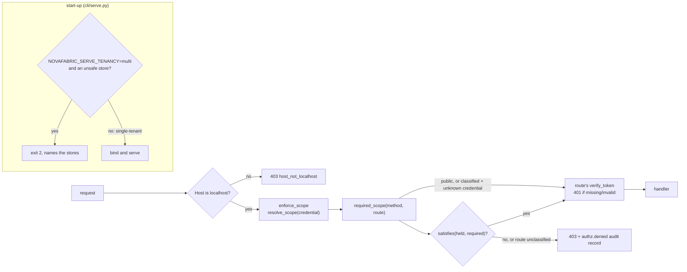

# The `nova serve` request path

[Architecture, as built](README.md) › `nova serve` request path

`nova serve` is the local dashboard and its `/api/*` routes. This page follows
one HTTP request from the socket to the handler and names every place it can be
refused. Three decisions shape the path:

- **ADR-0228, authorization** (experimental): every route has a required scope
  in one table, and a route missing from the table is denied to everyone.
- **ADR-0229, tenancy posture** (experimental): `serve` refuses to start in
  multi-tenant mode while any store it reads cannot filter by tenant.
- **ADR-0231, audit enrichment** (experimental): each 403 from the scope check
  writes one audit record that says how well it knows the actor.

## Step by step

| # | What happens | Code | Status |
|---|---|---|---|
| 1 | At start-up, before the token is minted or a socket is bound, `assert_multi_tenant_ready` reads `NOVAFABRIC_SERVE_TENANCY`. Anything but `multi` means single-tenant, the default. In `multi` mode, any store classed `unsafe` stops the process with exit code 2 and a message naming each store and why. | `cli/serve.py`, `serve/tenancy.py:assert_multi_tenant_ready` | experimental |
| 2 | The `host_header_guard` middleware rejects a `Host` header other than `localhost`, `127.0.0.1` or `[::1]` with 403 `host_not_localhost`. It runs before any dependency, so no scope check and no audit record happen. This is the DNS-rebinding defence. | `serve/app.py:host_header_guard`, `serve/auth.py:is_localhost_host` | works today |
| 3 | `enforce_scope` is one dependency mounted on the whole app, so routers added later inherit it. It reads the credential (`Authorization: Bearer`, else `?token=`) and maps it: the server's `.serve-token` holds `admin`; a token issued by `POST /api/admin/tokens` holds the scope it was minted with; a token record with no `scope` field (issued before scopes existed) reads as `admin`; a record whose `scope` is not recognised holds **no** scope. | `serve/authz.py:build_authz_dependency`, `resolve_scope`, `record_scope` | experimental |
| 4 | `required_scope` looks up `(method, route template)` in `ROUTE_SCOPES`. A `public` route passes. On a **classified** route, a missing credential or one the server does not recognise also passes this step, so that the route's own `verify_token` answers **401**. An **unclassified** route is not deferred, because it may have no `verify_token` of its own. | `serve/authz.py:required_scope`, `ROUTE_SCOPES` | experimental |
| 5 | `satisfies(held, required)` decides. If it fails, the credential holds no scope, or the route has no entry in the table (whoever is asking, anonymous callers included), the answer is **403**, and one `authz.denied` record is appended to the dashboard audit log. | `serve/authz.py:satisfies`, `_audit_denial`, `serve/audit.py:append` | experimental |
| 6 | Otherwise the route's own `verify_token` dependency checks the credential again (401 if missing or invalid) and the handler runs. | `serve/app.py:verify_token` | works today |

WebSocket routes (`/api/tv5/ws`, `/topology/stream`) are skipped by
`enforce_scope` and keep their inline host and token checks. Scope on a
long-lived subscription is still an open question (ADR-0228 OQ-2).

## The scope rules

| Held | Satisfies |
|---|---|
| `admin` | every scope, including `audit` |
| `operate` | `operate`, `read` |
| `read` | `read` |
| `audit` | `audit`, `read`, and **nothing else** |
| any | a `public` route |

`public` is a property of a route, never of a credential: `parse_scope` cannot
produce it. A stored token record is read by `record_scope`:

| `scope` field in `tokens.jsonl` | Held scope |
|---|---|
| absent (written before ADR-0228) | `admin`, which it could already do (D4) |
| exactly `read`, `operate`, `admin` or `audit` | that scope |
| anything else: a typo (`admn`), other case (`Admin`), padding, `public`, `""`, `null`, a non-string | **none**: authenticated, but refused on every non-public route |

Matching is exact, it logs a warning, and it never raises, so a hand-edited
token file can neither take the server down nor grant admin by mistake.
`POST /api/admin/tokens` already refuses an unknown scope with 422 at issue time.

**Unclassified means denied.** A route missing from `ROUTE_SCOPES` gets 403 with
the server token, with any other credential, and with no credential at all
(ADR-0228 D3). A forgotten classification then breaks a feature loudly instead
of disclosing evidence quietly. A CI guard fails on the first unclassified
route.

## The audit record for a 403

`_audit_denial` writes to `$NOVAFABRIC_HOME/dashboard-audit.jsonl` (override:
`NOVAFABRIC_DASHBOARD_AUDIT_FILE`):

| Field | Value |
|---|---|
| `action` | `authz.denied` |
| `required_scope` / `held_scope` | top-level fields; `required_scope` is `unclassified` when the route has no entry, `held_scope` is `none` for a credential holding no scope or no credential |
| `resource` | `"<METHOD> <route template>"` |
| `actor_token_fp` | `local` for the `.serve-token`, the issued token's fingerprint, or `anonymous` |
| `identity_source` | `shared-token` for the one `.serve-token` and for an anonymous caller; `credential` for an issued token |
| actor ID | omitted for `shared-token`, the token fingerprint for `credential` |

The record never contains the presented secret. A 401 writes nothing, because a
401 is usually a stale browser tab. If writing the record fails, the failure is
logged and the 403 still stands: an audit failure never grants access.

Records written by a route itself (not by the scope check) carry the
`verify_token` fingerprint in `actor_token_fp`. For the server token that is
`serve/auth.py:token_fingerprint`: 12 hex characters of a domain-separated
SHA-256 of the token. It is stable for a given token and never a slice of it.
Before this fix, it was the first eight characters of the plaintext token. Audit
records written then still hold that prefix, so rotate the serve token if those
records have left the machine.

## Paths taken from a request

Some routes take a server-side filesystem path in the request body. Each one is
confined by `serve/paths.py:confine` to an allowlist of roots. The path is
resolved (`~` expanded, every symlink followed) before the check, and any `..`
segment is refused outright. A path outside the roots gets **403**. An empty
path, a NUL byte, or a path that cannot be resolved gets **400**.

| Kind | Roots | Fields |
|---|---|---|
| write | `$NOVAFABRIC_HOME/exports`, `$NOVAFABRIC_HOME/evidence`, `$NOVAFABRIC_EVIDENCE_DIR` | evidence `output_path`, policy-sign `db_path`, capsule-migrate `output`, rebuild `target_db` |
| read | `$NOVAFABRIC_HOME`, the server's capsule dir, and the write roots | evidence `key_path`, policy-sign `key_path`/`cert_path`, capsule-migrate `source`, `capsule_path` (lineage import, KG ingest/detect/attack-path/blast-radius), KG ingest-all `capsule_base`, policy-test `bundle_path` |

A relative path is taken relative to the first root of its kind:
`$NOVAFABRIC_HOME` for reads, `$NOVAFABRIC_HOME/exports` for writes. The write
roots leave out the rest of `$NOVAFABRIC_HOME` on purpose, because it holds
`.serve-token`, `tokens.jsonl`, the audit log and the registry. An operator adds
directories to both lists with `NOVAFABRIC_SERVE_PATH_ROOTS` (absolute paths,
separated by `os.pathsep`). Server-chosen defaults, such as the evidence bundle
path when `output_path` is omitted, are not request input and are not confined.
`NOVAFABRIC_SERVE_ALLOW_ANY_PATH` is no longer honoured, and `nova serve` warns
at start-up if it is set.

Limit: the path is resolved when the request arrives. Someone who can already
create a symlink inside a root can swap it before the route uses the path. No
route lets a request create a symlink.

## Single-actor promotion

`POST /api/assets/{name}/{version}/promote` and its by-id alias call
`registry.service.promote_asset_direct`. That is the same gate as
`nova promote direct` (ADR-0312 D1), so the HTTP routes refuse and allow exactly
what the CLI does. A protected stage (`production`) needs an explicit
`promote_direct` policy allow, and `force` does not bypass it. With no OPA, the
`NoopEngine` gives no explicit allow, and the route answers **403**. The policy
`subject.user` is `serve:<credential fingerprint>`. It is never the
caller-chosen `actor` field, which is recorded only as `promoted_by`.

## The tenancy posture

Each store in the `serve` read path declares one of three classes in
`STORE_TENANCY`, and a test re-checks each claim against the store's real schema:

| Class | Stores |
|---|---|
| `aware` (can answer "only tenant X's rows") | `metadata_store`, `evidence_fabric`, `cost_store`, `object_capsule_store` |
| `agnostic` (isolated by the deployment) | `capsule_dir` |
| `unsafe` (would mix tenants) | `runs_cache`, `knowledge_graph`, `lineage_store` |

Because three stores are unsafe, including the runs index behind `/api/runs`,
multi-tenant `serve` is refused at start-up rather than served with some panels
scoped and others not. `GET /api/doctor` reports the posture in both modes under
the `tenancy_posture` check. For multi-tenant deployments, use `nova server`
(see [Server data plane](server-data-plane.md)).

## Not implemented yet

- Per-request tenant selection. `serve/tenancy.py:select_tenant` exists and is
  unit-tested, but no route calls it. **planned**, once `runs_cache` gains a
  tenant column (ADR-0229 OQ-1).
- Roles written through `POST /api/admin/roles` are not read back as scopes in
  `serve`. That endpoint is `admin`-gated.
- Scope on WebSocket subscriptions (ADR-0228 OQ-2).

## Read next

- [Dashboard security model](../dashboard.md) (minting a narrower token)
- [OTLP ingest](otlp-ingest.md): two `operate` routes on this path
- [Deployment topologies](deployment-topologies.md)
