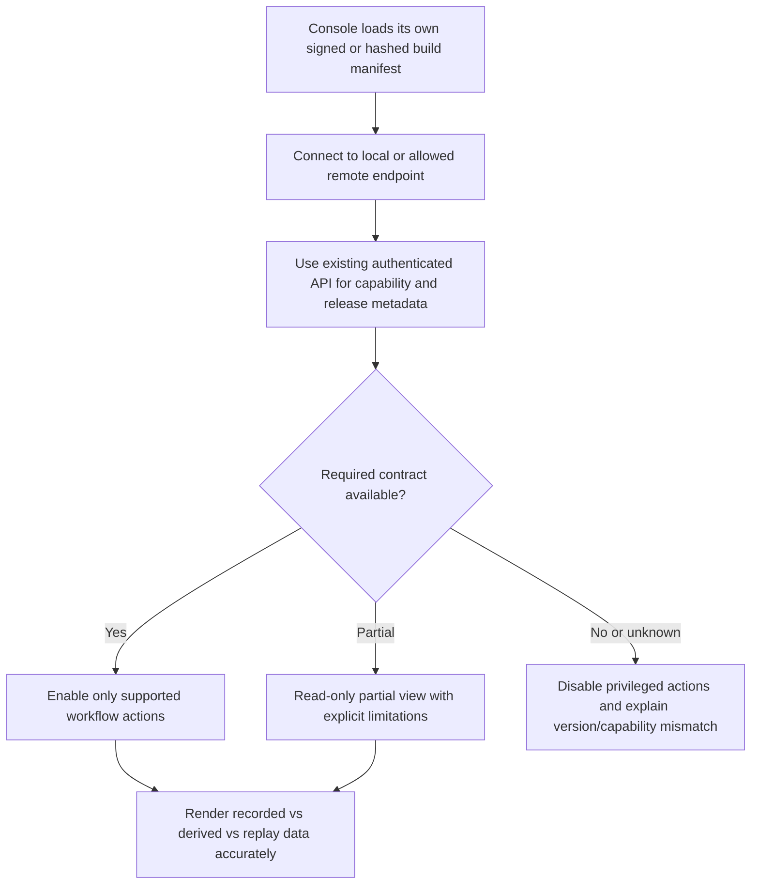

# Console 2.0 — frontend architecture decision and multi-layer versioning

**Status: PROPOSED; not an accepted ADR or implemented change.**  
**Review date:** 2026-11-22 (Europe/Rome). **Source observed:** public `main` at `4f89480c2de83f0f51003cb096db58b9904a4ce5`.  
**Parent:** [Console program #252](https://github.com/MSKazemi/novafabric/issues/252). **Tasks:** architecture [#262](https://github.com/MSKazemi/novafabric/issues/262); versioning [#263](https://github.com/MSKazemi/novafabric/issues/263); migration [#264](https://github.com/MSKazemi/novafabric/issues/264). **Earlier proposal:** [Console roadmap](console-2-modernization.md).  
**Decision owner:** maintainer after a comparative technical+UX spike. This document explicitly **opens** the earlier decision to retain Astro. No public code or release policy is altered merely by merging this document.

## Why the program needs a fresh architecture choice

The current frontend is not a blank canvas; it contains two independently built, Python-bundled UI surfaces:

| Surface | Observed source | Build/runtime and packaging | Package metadata |
|---|---|---|---|
| Embedded Console | `ui/dashboard/` | Astro 7 + React 19 client-only dashboard; `build:dashboard` copies JS/CSS into `src/novafabric/serve/static/`, served at `/dashboard/` | `name: novafabric-showcase`, `private:true`, `version:0.1.0` |
| Topology frontend | `packages/nova-dashboard/` | Vite + React 19 + Sigma/Graphology + Three and Zustand; Vite base `/topology/`, output `src/novafabric/serve/static/topology/` | `name:nova-dashboard`, `private:true`, `version:0.1.0` |

The embedded Astro route contains `<DashboardApp client:only="react" />`, so it is reasonable to test whether **React + Vite SPA** is a simpler architecture for this application shell. But Astro is already working and may be simpler to migrate in-place. A purely aesthetic preference is not adequate grounds for replacing it. **Choose on measured tradeoffs.**

**Crucial distinction:** the marketing site `novafabric.ai` is a separate product/codebase; this program only addresses the embedded console/topology interfaces, per ADR-0299. The backend stays Python; no Node.js server should become mandatory in production for the UI.

## Three architectural options, no predetermined winner

### A. Evolve existing Astro + React (low migration cost)

- Keep `ui/dashboard/src/pages/dashboard.astro` and `DashboardApp.tsx`; replace nav shell and visual design, create shared workspace context, improve routing, components and testability.
- Preserve old tab IDs, URLs, widget formats and commands; move advanced functions into an accessible tools directory.
- Keep topology app a separate lazily entered surface but unify visual tokens/connection model.
- Advantages: proven wheel integration and little migration risk; limitations: Astro pages include legacy marketing routes, two frontend builds and shared shell fragmentation.

### B. New React + Vite Console shell reusing domain components (strong-change candidate)

- Replace the embedded `client:only` Astro wrapper with a real React SPA served as static assets; reuse existing `RunsTab`, `DiffTab`, Evidence, Lineage and other domain components rather than reimplementing backend semantics.
- Use an explicit compatibility router translating existing `?tab=`, `?sub=`, run selection/filter URLs, `run_ids` comparisons and keyboard bindings.
- Build inside the current Python wheel static directory with deterministic, content-hashed chunks. Node only at build time.
- If no new browser-side app features justify the change in real benchmark/user tests, reject B.
- Advantages: single-client runtime architecture, simpler app-level routing/state; risks: large migration/test burden and temporary feature parity drift.

### C. One coherent Console + Topology user experience (can build on A or B)

- Share top navigation, token/capability model, design tokens, and linkable investigation context across `/dashboard/` and `/topology/`.
- Keep heavy WebGL/3D/Sigma behind lazy route/chunk. Choose whether to combine builds only after measuring bundle/wheel impact and deployment path compatibility.
- Forbid parallel independent user-role, policy and evidence-state implementations in each frontend.
- This option is a **product integration target**, not a requirement to force heavy graph dependencies into every page.

Reject blanket rewrites, mandatory hosted SSR/Node, full adoption of Next.js without a concrete offline need, and paid third-party UI services as defaults. A greenfield approach is permitted only if spikes establish a decisive reason that component reuse is untenable.

## Architecture decision gates — objective evidence

1. Two same-scope prototype spikes: Run→event trace, and Evidence→verification details, against the **same** local serve API and a realistic fixture (not visual-only mockup). Cover topology entry flow in both.
2. Compare with measured results and reproducible environment: build time, initial bytes and loaded bytes, wheel/static package size, FCP/INP-like browser responsiveness when instrumented, navigation latency, long trace, 100k indexed-run navigation, graph memory, browser console errors, incremental compile.
3. Compare security/posture: token paths, SSE subscriptions, XSS/DOM escaping, localhost binding, browser history/referrer, offline/no CDN/no telemetry, server-side authorization and capability gating.
4. Compare human-centered tasks: find a failure, explain replay semantics, compare two runs, distinguish cryptographic integrity from signer trust, export evidence; keyboard/tab/reader/zoom/reduced-motion tests.
5. Record **reuse/extension/replacement inventory** for each existing component, API binding, test, route, store and asset. Tab IDs can be hidden or reorganized visually, not silently broken.
6. Produce an accepted ADR (including why alternatives were rejected) before implementing a full migration under #255. An experimental spike is not a feature release.

## Versioning layers — observed vs proposed

| Layer | Observed | Recommended policy (not yet implemented) |
|---|---|---|
| **Python distribution and bundled Console** | `pyproject.toml: version=0.109.0` (as of `main` at v0.109.0; the earlier reviewed base was 0.108.0), installed metadata `novafabric.__version__` | The **shipped wheel** is the authoritative end-user version; its bundled UI is an exact build from that release. |
| **Console UX generation** | Console 2.0 is a proposed design name | `Console 2.0` means **experience generation**, not `pip install novafabric==2.0.0`. Do not force Python major bump. |
| **Embedded frontend package.json** | `novafabric-showcase@0.1.0`, `private:true` | Treat `0.1.0` as internal package metadata, never a public release badge. Consider renaming to `novafabric-console` in a focused PR after package audit. |
| **Topology frontend package.json** | `nova-dashboard@0.1.0`, `private:true` | Internal build identity until independently shipped; reuse distribution release or embed separate source/digest revision as appropriate. |
| **Frontend build identity** | Assets are content-hashed by build tooling; no explicit user-facing UI version contract verified | Generate a reproducible build manifest including commit revision, distribution version, asset digest and frontend build kind, with no private data. |
| **Local serve API** | `/api/*` unversioned; `GET /api/health` returns backend version | Preserve endpoint compatibility, extend authenticated capability metadata as necessary after API/security review; no silent rename to `/v1`. |
| **Multi-user server API** | `/v0/*`, and `/v0/version` already reports version, git SHA, schema revision, extras, features | Reuse existing structured identity; different API families must not be conflated. Govern breaking changes with current deprecation policy. |
| **Dashboard API schema** | `api/openapi-dashboard.yaml` has OpenAPI `version: 0.109.0` | CI compare generated OpenAPI spec/hash; track incompatible route changes independently of marketing UX label. |
| **Persistent database revision** | Two Alembic universes, accepted N/N+1 expand–contract contract | Keep existing migration contract; do not bump DB schema simply because UI design changes. |
| **Portable evidence formats** | Versioned Run Capsule / Evidence Bundle schemas | Independent canonical format versions; a visual redesign must not rewrite immutable capsule/evidence artifacts. |
| **Dashboard widgets & saved views** | Existing user-authored dashboard files and saved view/filter semantics | Additive parser; migration/rollback must keep existing user data and old URLs. |
| **Helm/OCI distribution** | Separate packaging/release flows | Follow trusted release pipeline and existing chart-versus-app version policies; do not invent a parallel console registry by default. |

### Recommended About / diagnostics display (example values illustrative)

```text
NovaFabric 0.109.0                  # from installed backend distribution
Console experience: 2.0 preview    # design generation / visible label, not PyPI version
Console build: abc1234             # actual built source SHA, no invented fallback
Console assets: sha256:...         # computed from shipped static manifest
Serve API: legacy /api             # actual active connection
Server API: /v0 (if applicable)    # only when available
Capabilities: run-read, diff-read, evidence-verify...
Backend: connected / incompatible / partial / unauthorized
```

Never show a sample digest or a guessed version in actual UI. Sensitive server identity must be available only to appropriately authorized clients. Expose only safe metadata over public health probes.

### Compatibility handshake and fallback



- **Wheel embedded:** frontend and Python backend are tested and released as one artifact; default to exact bundled versions, no independent npm publication.
- **Standalone UI:** *not declared supported* until an explicit compatibility test matrix exists. Proposed initial policy is at most one supported adjacent backend minor while API remains experimental, but this must be tested and approved; capability negotiation should control individual features.
- Test UI-old↔backend-new, UI-new↔backend-old, API missing method, `401`/`403`, `ok:false` in-band error, partial/truncated data, old bookmark, expired/stale chunk, stale service worker where relevant, topology mismatch, schema unknown and offline startup.
- Cache rules: hashed immutable JS assets; HTML and capability metadata must not be indefinitely cached. Static files must survive wheel build and be verifiably tied to exact source. No silent self-updating UI or CDN.
- On unsupported backend feature, show `Unavailable on this server` / `Insufficient permission` rather than inventing a fallback result.
- Security-changing operations require separate RFC/threat-model review; UI hiding controls never substitutes for server authz.

## Product requirements additionally missing from the first epic

1. **Unified novice-to-expert experience:** role/task-based navigation, progressive disclosure, safe first-run walkthrough, empty states, copyable CLI commands and Help.
2. **Cross-frontend coherence:** consistent design tokens, navigation, auth/capabilities and provenance semantics between Console and topology.
3. **Evidence-honest UI:** each number and status has source, completeness, time/window and verifier trust dimension; no fabricated metrics in live runtime.
4. **UI product contract:** deep links, saved investigations, permalink security, workspace presets and persisted preferences explicitly versioned and reversible.
5. **Extensibility:** evaluate safe feature-panel/plugin mechanism that adds views without giving third-party UI authority to access secrets or perform side effects; first do an RFC.
6. **Performance at realistic scale:** bounded queries, virtualization, streaming backpressure, worker/throttled graph layout and lazy topology/Monaco chunks, tied to existing #260 synthetic harness and #253 browser measurements.
7. **Accessibility/localization:** WCAG 2.2 AA, keyboard-only graph/table fallback, high contrast, zoom, reduced motion, timezones and locale-safe dates; full i18n only if demand justified, no mandatory translation service.
8. **Security and privacy:** strong CSP strategy, token transport/privacy, `ok:false` refusal handling, permission/capability gating, audit trail for destructive controls, redaction and no telemetry.
9. **Operational resilience:** offline/local-first, reconnect/backoff, truthful stale-data badges, recoverable errors, pagination and cancellation, browser crash/reload state recovery without saving raw secrets.
10. **Release engineering & developer experience:** version identity, CI contract tests, visual regression baselines, reproducible wheel, smoke test actual packaged UI, rollback, debugging diagnostics and concise contribution boundaries.

## Responsibilities and relationships

- Program: #252; existing #253 audit, #254 prototype evaluation, #255 implementation, #256 advanced surfaces.
- New decision tasks: [#262 architecture](https://github.com/MSKazemi/novafabric/issues/262), [#263 versioning](https://github.com/MSKazemi/novafabric/issues/263), [#264 cutover](https://github.com/MSKazemi/novafabric/issues/264).
- Existing release work: #211 (CI/CD), #220 (provenance), #225 (offline golden evidence), #250 (native project/milestone provisioning), #260 (synthetic scale harness). Reuse, do not duplicate.
- No automatic assignment, calendar deadline, new deployment, package publication or accepted ADR in this document.

### Implementation order and signoffs

```text
#253 source & runtime baseline ────────┐
#254 task prototypes & user research ──┼─> #262 architecture ADR & #263 version contract
                                       │                       |
                                       └───────────────────────┤
                                                               v
                                                         #255 first slice
                                                               |
                                                               v
                                            #264 migration/release validation
                                                               |
                                                               v
                                                 #256 expanded experiences
```

The architecture decision may be made with incomplete user research only if limitations are explicit and maintainer accepts the risk. **No permanent frontend migration** until architecture and API compatibility are reviewed.

## Claude Code starting instructions

Create *only* a focused architecture audit and optional two proof-of-concept branches. Read `AGENTS.md`, `ui/dashboard/README.md`, `docs/dashboard.md`, `docs/architecture.md`, `docs/release-process.md`, `docs/ops/upgrade-guide.md`, `ui/dashboard/src/pages/dashboard.astro`, current backend health/version API, `packages/nova-dashboard/vite.config.ts`, existing assets/packaging tests and issues #253/#254/#262/#263. Deliver comparative measurements, real screenshots, security compatibility analysis, an ADR draft, migration mapping and test logs. Do not merge, deploy, add mandatory cloud dependencies, publish independent frontend releases, change immutable format schemas or claim unrun tests passed.
