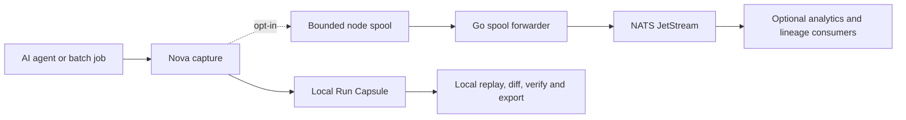

# Installation options and software stack

NovaFabric has **one Python package** with optional extras and optional external
services. You do **not** need to install every database, broker or cluster
component to capture, replay, diff, trace lineage or verify evidence.

**Start with the local installation unless you have a demonstrated need for
shared access or distributed collection.** The Run Capsule is the source of
execution evidence; metadata and graph indexes do not replace it. The only
top-level interchange formats are the **Run Capsule** and **Evidence Bundle**.

This is a **deployment guide, not a commercial edition list**: all five
user-facing profiles below use the same Apache-2.0 project and underlying
formats. They map onto the Local / Server / Cluster architecture described in
[deployment topologies](architecture/deployment-topologies.md). Maturity labels
describe the current implementation, not a production SLA or certification.

## Choose an installation profile

| Profile | Best for | Python install | Storage and external services | Maturity |
|---|---|---|---|---|
| **Light (CLI)** | Individual developers, researchers, CI | `pip install novafabric` | Local filesystem + Python's SQLite; **no external service** | **works today** (beta) |
| **Desktop (CLI + dashboard)** | Local inspection and demonstrations | `pip install 'novafabric[serve]'` | Same local files and SQLite; local web server, no separate DB | Core **works today**; dashboard **experimental** |
| **Team (shared server)** | A single organization's shared API | `pip install 'novafabric[server]'` | Server filesystem for capsules; SQLite for evaluation, **PostgreSQL recommended** for a shared deployment | **experimental**, single-tenant |
| **Enterprise / regulated** | Teams needing identity, signing, retention and policy checks | `novafabric[server]` plus selected extras | PostgreSQL, authenticated/TLS server, optional signing, WORM store and policy services | **experimental**; not a validated enterprise product |
| **Factory (HPC / clusters)** | Many independent capture nodes | Core on capture nodes; optional scale/collector integrations | Node spools, separate Go forwarder, NATS JetStream, downstream indexes and optional object storage | **experimental**; further integration work is not scheduled |

**These are five ways to explain three architectural tiers**, not five separate
binaries: Desktop is a local-mode option; Enterprise adds regulated controls to
the server tier. Factory extends collection for cluster workloads. A higher
profile must never force an external dependency into Light mode.

**What is not automatically installed:** PostgreSQL, ClickHouse, JanusGraph,
NATS, Kafka, a model-serving stack, Kubernetes or a cloud account. Installing
a Python *extra* adds Python packages; it does **not** provision a database
server, object-store bucket, identity provider or message broker.

## Light: install the CLI (works today)

Prerequisites: **Python 3.12+**, `pip` or `uv`, and a writable directory.
SQLite is provided by Python, so there is no SQLite server to install.

```bash
python -m pip install novafabric
nova --version
nova doctor --check-extras
nova capture python my_agent.py
```

Use the run ID printed by capture with `nova validate`,
`nova replay --mode forensic`, `nova diff` and `nova lineage`.
See the complete [Getting Started tutorial](getting-started.md) for
tested example workflows and how to create an Evidence Bundle.

Defaults:

- Capsules: `~/.novafabric/capsules/<run-id>/`
- Local registry / lineage index: `~/.novafabric/registry.db` (SQLite)
- Additional metadata may be stored in `~/.novafabric/metadata.db`
- Override the data directory with `NOVAFABRIC_HOME` as needed

The **core workflow requires no server or internet connection**. Your
captured *application* may still require network access or an LLM API key;
NovaFabric does not supply an LLM. Local cryptographic sealing is opt-in.

## Desktop: local dashboard (experimental)

```bash
python -m pip install 'novafabric[serve]'
nova serve --experimental
```

The experimental local dashboard starts on `127.0.0.1:4321` by default and
uses the local capsules and registry. Its frontend is bundled with the
installed wheel: **Node.js is needed to develop/build the UI, not to use
the installed dashboard**.

The dashboard is **not read-only**: some operations can modify or delete
evidence. Keep it bound to loopback for local use and protect its access
token. Do not expose it to the internet as a convenient substitute for
a hardened server. See [Dashboard](dashboard.md).

## Team: shared REST API (experimental)

```bash
python -m pip install 'novafabric[server]'
nova server start
```

This launches the experimental API on `127.0.0.1:7433` by default. Without
a configured identity provider, it uses local bearer-token authentication.
The default backend can be SQLite for single-host evaluation; **PostgreSQL
is an opt-in external service**, recommended for a shared team deployment.

For PostgreSQL, first provision a database securely and configure the server
process environment with `NOVAFABRIC_POSTGRES_DSN`,
`NOVAFABRIC_METADATA_DSN` and
`NOVAFABRIC_METADATA_BACKEND=postgres`. Do not put passwords or signing
keys in the server YAML or paste credentials into documentation.

After configuring the connection and before starting the server:

```bash
nova db upgrade --track registry --backend postgres
nova db upgrade --backend postgres
nova server start --backend postgres
```

These commands are **not** a one-command production installer: database
provisioning, auth, TLS, persistent filesystem storage, backups and recovery
remain operator responsibilities. Configure access through TLS and an
appropriate identity provider or protected local token. The current server
is **single-tenant by default**, and multiple Uvicorn workers do **not**
constitute independently validated high availability.

Follow [Server Deployment](ops/server-deployment.md) for the exact
configuration and migration sequence, [Server Administration](ops/server-admin-guide.md)
for security/operations, and [Sizing](ops/sizing-guide.md) for capacity estimates.

## Enterprise / regulated: select controls, not a separate product

This is a **target operating profile**, not a shipping
`novafabric[enterprise]` package or an assertion of regulatory certification.

Begin with a securely configured Team server, and enable only the
capabilities your evidence policy requires:

| Requirement | What to configure |
|---|---|
| Authentication / authorization | Server OIDC/JWKS, RBAC and API keys; optional SAML (`[saml]` extra) |
| Cryptographic evidence | Local NovaSeal keys (no extra required for the core path); optional `[sigstore]` or cloud KMS extras |
| Durable retention | Existing WORM adapters: `[worm-s3]`, `[worm-azure]` or `[worm-gcs]`, chosen for your actual storage provider |
| Merkle log on PostgreSQL | Optional `[seal-postgres]` extra and a provisioned database |
| Compliance exports | Optional `[compliance]` extra; exports are **evidence**, not certification |
| Policy gates | Configure the existing policy/OPA integration where appropriate; there is **no current `[policy]` package extra** |
| Operations | TLS, secret management, backup/restore, retention tests, auditability, least privilege and incident response |

Cloud SDK extras add clients; they do not create buckets, WORM policies
or KMS keys. An external RFC 3161 timestamp authority is optional and may
be internal in an air-gapped environment.

Read [NovaSeal configuration](novaseal-configuration.md),
[Backup and restore](ops/backup-restore.md),
[Upgrades](ops/upgrade-guide.md) and
[Air-gapped installation](ops/air-gapped-install.md).

## Factory: HPC and distributed collection (experimental / partial)

Capture remains non-blocking by default. The cluster design keeps database
and graph writes **off compute-node hot paths**:



The spool, forwarder and NATS consumer paths are **experimental**. The
central server does **not** automatically ingest the cluster event stream:
capsule upload or directory indexing is a separate path. The HPC hub
signing pipeline is **planned**; fully integrated multi-cluster operation is
**future design**. There is **no production-validated,
single-command Factory installation**.

Use [Operator Guide](operator-guide.md),
[Deployment topologies](architecture/deployment-topologies.md) and
[Cluster-scale migration](ops/cluster-scale-migration.md) when evaluating
HPC/SLURM, Kubernetes and collector components.

## Database, storage and broker inventory

| Component | Role | Required when? |
|---|---|---|
| **SQLite** | Local registry, metadata and lineage | **Light and Desktop default**; built into Python |
| **PostgreSQL** | Shared metadata / registry, role-aware queries | **Optional**, recommended for Team+; separately operated |
| **DuckDB** | Embedded derived query / analytics accelerator | Optional `[query]` or `[scale]` extra; `nova query` can use SQLite instead |
| **Kuzu** | Optional embedded lineage/graph backend | Optional `[lineage-kuzu]` extra |
| **ClickHouse** | Higher-volume cost and event analytics | Optional external service + `[clickhouse]` client extra |
| **Apache AGE** | Alternative graph backend inside PostgreSQL (**experimental**) | Optional, not an additional default DB |
| **JanusGraph** | Distributed lineage graph backend | Optional external service + `[janusgraph]` client extra |
| **Filesystem** | **Authoritative Run Capsules** | Required for current local and server paths |
| **S3-compatible / cloud object storage** | Backups, retention and experimental capsule object store | Optional; not yet wired into live server capsule routes |
| **NATS JetStream** | Async delivery from cluster spools | Optional broker for cluster experiments, **not a database** |
| **Kafka / PgBouncer** | Kafka: only a service in the compose `prod` example, with no Kafka integration in `src`; PgBouncer: PostgreSQL connection pooling | Optional advanced services; **not default dependencies** |

Metadata indexes are generally derived and often rebuildable; this is **not**
permission to discard non-rebuildable registry history, Merkle log entries,
original capsules or backups. Consult [Sizing](ops/sizing-guide.md).

## Software stack by layer

| Layer | Current stack |
|---|---|
| AI workload integration | Python SDK hooks, HTTP/MCP proxies, OpenTelemetry GenAI and framework adapters |
| Capture and evidence | Python orchestrator, JSONL/YAML capsule files, JSON Schema, redaction and DSSE signatures |
| Persistence | Local filesystem and SQLite; optional PostgreSQL, graph and analytics backends |
| Replay / query / lineage | Python engines, NetworkX, optional DuckDB and Kuzu |
| API / authentication | FastAPI, Uvicorn, OIDC/JWKS, RBAC |
| Browser interface | Prebuilt Astro + React + TypeScript UI (experimental) |
| Cluster transport | Optional Go spool/forwarder, NATS JetStream and consumers (experimental) |
| Packaging / operations | PyPI extras, Docker Compose, Helm, Kubernetes, SLURM, CI and offline wheel mirroring |

There is **one underlying evidence contract** across these deployment profiles;
do not fork the capsule format for an enterprise or cloud variant.

## Security and production-readiness limits

- **Capsules may contain sensitive model inputs and outputs.** The current
  Python capture hooks can write request messages and model responses to
  `model-calls.jsonl` by default. A redaction proof documents scanning, **not
  a guarantee that every secret or personal datum was removed**. Treat
  capsules as sensitive and review [architecture invariants](architecture.md#design-invariants)
  before capturing production workloads.
- **The shared server currently serves capsule bytes from a filesystem.**
  Its separate object capsule store is experimental and used for other
  operations, but **server capsule routes are not object-store-backed**.
  Do not claim stateless replicas or automatic failover.
- **Compose's `prod` profile is an advanced integration/example stack**, with
  optional ClickHouse, NATS, Kafka, PgBouncer and JanusGraph. It is **not
  proof that these services are required or that its example credentials are
  production-safe**. See [Compose source](../deploy/docker/docker-compose.yml).
- **Helm defaults to authenticated server mode**; its bundled PostgreSQL is
  for evaluation. Production operators must supply appropriately secured
  persistence, secrets, TLS and recovery checks. See
  [Helm deployment](../deploy/helm/novafabric/README.md).
- Installation does not equal production validation, regulatory compliance
  certification or a managed hosted service.

## Next steps

| Your goal | Read |
|---|---|
| First capture, validate, replay and diff | [Getting Started](getting-started.md) |
| Shared server and PostgreSQL setup | [Server Deployment](ops/server-deployment.md) |
| Local browser interface | [Dashboard](dashboard.md) |
| Container, SLURM or Kubernetes capture | [Operator Guide](operator-guide.md) |
| Offline installation | [Air-gapped installation](ops/air-gapped-install.md) |
| Backups, recovery and sizing | [Backup/restore](ops/backup-restore.md) and [Sizing](ops/sizing-guide.md) |
| Architectural maturity and gaps | [Deployment topologies](architecture/deployment-topologies.md) and [Roadmap](../ROADMAP.md) |
| Exact supported Python extras | [`pyproject.toml`](../pyproject.toml) and `nova doctor --check-extras` |
