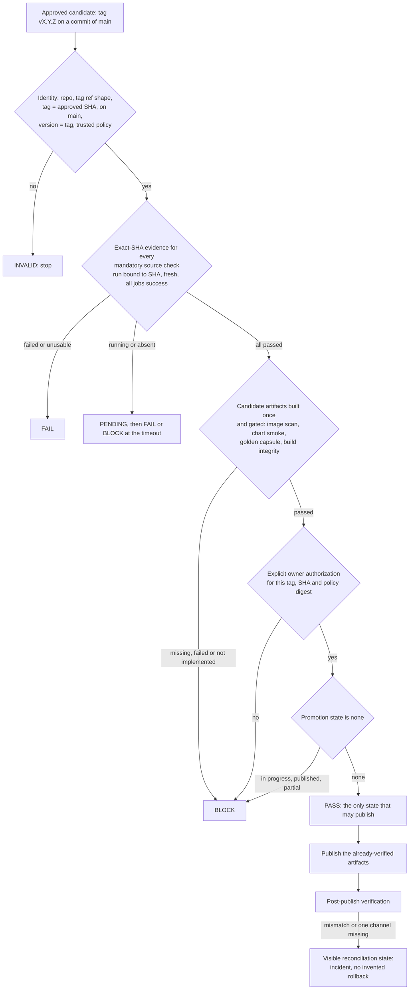

# Release verdict — design proposal for issue #219

> **Status: planned (design only, not activated).** Nothing described here runs in a
> release. The pure decision function and its offline tests are in the repository
> (`scripts/require_green_ci.py`, `tests/test_release_verdict.py`), but no workflow calls
> them. The production gate is still the one in [release-process.md](release-process.md):
> wait for the `ci.yml` run on the tagged commit. Changing that is an owner decision (see
> [Decisions](#owner-decisions-and-prerequisites)).

## Why

A release is published by four tag-triggered workflows (GitHub Release, PyPI, container
image, Helm chart). Each sits behind one reusable job, `require-green-ci.yml`, which asks a
single question: *did `ci.yml` succeed on this exact commit?* That closes the v0.106.0 hole
(a release published over a red CI), but it answers only that question.

### The real incident: v0.109.0

All of the following are GitHub Actions run records on commit
`9b7b31b9d54af55308f9c6b5b3b07304d8a9e5ed` (2026-11-22).

| Run | Workflow | Trigger / ref | Conclusion |
|---|---|---|---|
| [45044063266](https://github.com/MSKazemi/novafabric/actions/runs/45044063266) | CI | push / `main` | success |
| [45046197086](https://github.com/MSKazemi/novafabric/actions/runs/45046197086) | Collector CI | push / `v0.109.0` | **failure** — job `Vulnerability Scan` (`govulncheck`) |
| [45046197063](https://github.com/MSKazemi/novafabric/actions/runs/45046197063) | Release | push / `v0.109.0` | success |
| [45046196973](https://github.com/MSKazemi/novafabric/actions/runs/45046196973) | Publish to PyPI | push / `v0.109.0` | success |
| [45046197296](https://github.com/MSKazemi/novafabric/actions/runs/45046197296) | Publish container image | push / `v0.109.0` | success |
| [45046197111](https://github.com/MSKazemi/novafabric/actions/runs/45046197111) | Publish Helm chart | push / `v0.109.0` | success |

`govulncheck` reported `GO-2026-6859` (`net/http` in Go 1.26.10, fixed in 1.26.11). The
collector's Go version has since been raised, so this is a **historical** failure, not a
current vulnerability. The point is the process: a security workflow was red on the release
commit and nothing could notice, because nothing asked.

A second gap shows in the same record set: `npm-audit` has path filters, so it produced **no
run at all** on that commit. A policy that requires evidence on the release SHA must be
told how to get it (see prerequisites).

## What exists today versus what is proposed

| Question | Today (`require_green_ci.py` `verdict`) | Proposed (`decide_release`) |
|---|---|---|
| Which checks count | `ci.yml` only | A reviewed manifest: mandatory, informational, not-yet-implemented |
| Collector CI / audits / license / metadata gate | Not consulted | Mandatory, same SHA |
| Failed job inside a "successful" workflow | Not looked at | Every job of the deciding run must be `success`; a required job that is missing or `skipped` fails |
| Evidence for a different SHA | Filtered by the query only | Any run bound to another SHA → `INVALID` |
| Fork or unexpected workflow file | Not checked | `INVALID` |
| Stale evidence | Not checked (CI) | Audit evidence older than its manifest bound is not evidence |
| Tag commit on `main` | Not checked | Required (compare status), else `INVALID` |
| Tag ↔ approved SHA ↔ package version | Not checked | All three must agree |
| Dispatch from any branch | Gate runs on that ref's HEAD | `INVALID`: only an immutable `vX.Y.Z` tag ref can be a release |
| Who supplies the policy | The candidate's own checkout | The evaluated manifest must equal a trusted digest the candidate cannot set |
| Owner authorization | Implicit in pushing a tag | Explicit record bound to tag, SHA and policy digest, else `BLOCK` |
| Duplicate / partial promotion | Not modelled | `BLOCK`, with a reconciliation instruction |
| Unimplemented check | n/a | Never passes (`BLOCK`) |

## The verdict

One pure function, one result. States, from most to least severe:

| State | Meaning | Authorizes |
|---|---|---|
| `INVALID` | The request is not a release of this repository: wrong repo, wrong ref shape, tag/SHA/version/ancestry mismatch, policy not the trusted one, or evidence bound to another SHA / fork / workflow | no |
| `BLOCK` | A prerequisite of promotion is unmet: no matching owner authorization, a candidate-artifact gate failed or is missing, a check is not implemented, or a promotion is already running, published or partial | no |
| `FAIL` | A mandatory source check failed, or evidence could not be fetched or validated | no |
| `PENDING` | Mandatory evidence is still running or absent **within the allowed wait**. After the timeout it becomes the check's failure state (`FAIL` for source checks, `BLOCK` for candidate-artifact gates) | no |
| `PASS` | Every applicable mandatory check passed on the approved SHA, identity and authorization hold, nothing is in flight | **yes** |

The worst state wins (`INVALID` > `BLOCK` > `FAIL` > `PENDING`). Only `PASS` may authorize
a release. The function does no I/O: callers fetch run and job payloads, `parse_runs` and
`parse_jobs` reject malformed, truncated (pagination) or identity-less data, and
`decide_release` decides from those facts, a clock value and the time already waited.

### Evidence rules (per mandatory check)

1. Every run must be bound to the approved SHA, the canonical repository and the expected
   workflow file; otherwise `INVALID`.
2. Only runs with an allowed event count: a push on `main` or on the release tag, a
   scheduled run where the manifest allows it (and then only within its age bound), or a
   manual dispatch **on the release tag**. A dispatch from any other branch is ignored.
3. The newest eligible run decides. A later failure beats an earlier success; a later
   successful re-run of the same SHA after a failure is eligible.
4. The run must be complete and `success`, and its jobs must have been retrieved: every
   required job present and `success`, and, for a workflow check, no other job in the run
   failed or skipped.
5. Waivers are not an input. A waiver (for example an audit exception with an expiry date)
   lives inside the check; the verdict sees only whether the check passed. An expired waiver
   therefore fails the check and the release.
6. An informational check never blocks and never substitutes for a mandatory one.

## Release identity

The caller supplies these facts from trusted sources (not from the candidate's files):

| Fact | Required value |
|---|---|
| repository | the canonical `MSKazemi/novafabric` |
| event | `push` of a tag, or `workflow_dispatch` **on** that tag |
| ref | `refs/tags/vX.Y.Z` (immutable release tag) |
| approved SHA | full 40-hex lowercase; equals what the tag resolves to |
| ancestry | `compare(base=<sha>, head=main)` is `ahead` or `identical` |
| package version | equals the tag without the leading `v` |
| policy | its digest equals a trusted digest held outside the candidate |
| authorization | names the same tag, SHA and policy digest, with an approver |
| promotion state | `none` (not in progress, published or partial) |

Release tags stay immutable (a ruleset already forbids moving or deleting `v*` tags). Trusted
publishing to PyPI, keyless signing, provenance and the minimal permissions of the publish
jobs are not touched by this design.

## Mandatory-check manifest (version 1)

`RELEASE_POLICY_V1` in `scripts/require_green_ci.py`. A check's `on_failure` is the
verdict a failed or absent check produces.

| Key | Workflow | Required jobs | Events accepted | Max age | On failure | Status |
|---|---|---|---|---|---|---|
| `ci` | `ci.yml` | lint, unit (1–6/6), coverage, typecheck, seal-latency-gate, capture-overhead-gate, web, integration | push, dispatch | — | FAIL | implemented |
| `collector-ci` | `collector-ci.yml` | Lint, Vulnerability Scan, Unit Tests, Spec Corpus Validation, Build Artifacts, Security Scan | push | — | FAIL | implemented |
| `pip-audit` | `pip-audit.yml` | pip-audit (locked deps) | push, schedule, dispatch | 24 h | FAIL | implemented |
| `npm-audit` | `npm-audit.yml` | three package trees | push, schedule, dispatch | 24 h | FAIL | implemented, **needs evidence on the release SHA** |
| `license-policy` | `license-policy.yml` | license policy | push, schedule, dispatch | — | FAIL | implemented |
| `metadata-store-security-gate` | `metadata_store_security_gate.yml` | MetadataStore Security Gate | push, dispatch | — | FAIL | implemented |
| `golden-capsule` | `ci.yml` (job) | golden-capsule | push, dispatch | — | BLOCK | **not implemented** — #225 |
| `oci-candidate-scan` | candidate scan | candidate-scan | push, dispatch | — | BLOCK | **not implemented** — #218 |
| `helm-candidate-smoke` | Helm smoke | helm-smoke | push, dispatch | — | BLOCK | **not implemented** — #224 |
| `build-integrity` | build integrity | build-integrity | push, dispatch | — | BLOCK | **not implemented** — #220 |
| `scorecard`, `release-toolchain`, `docs`, `sdk-ts`, `capture-action` | as named | — | — | — | — | informational |

The workflow and job names of the four not-yet-implemented checks are placeholders: their
owning issues set the real names. While any mandatory check is unimplemented the manifest
cannot return `PASS` — by design. `tests/test_release_verdict.py` also pins every
implemented check's required job names to the real workflow files, so a renamed job fails a
test instead of failing a release.

The 24-hour bound for the two dependency audits and which informational workflows should
become mandatory are open decisions.

## Flow

The candidate-construction and post-publish boxes belong to other issues (#218, #220,
#221, #224, #225); #219 only defines the verdict they feed.

## Threat model

| Threat | Control in the verdict | Residual |
|---|---|---|
| A tag on a red or unrelated commit | exact SHA, ancestry on `main`, all mandatory checks | rulesets that stop red commits reaching `main` are #216 |
| Green run of another commit presented as evidence | any run bound to another SHA → `INVALID` | none for the pure function; fetching must use the SHA filter |
| A newer failing attempt hidden behind an older pass | newest eligible run decides | none |
| A security workflow that failed but is not consulted (the v0.109.0 case) | manifest of mandatory checks | the manifest itself is the control: changes need review and a new digest |
| Skipped or missing job inside a green workflow | required jobs must exist and pass; no failed/skipped sibling | a job renamed upstream fails a drift test |
| Stale dependency audit | per-check age bound | the bound is a policy choice |
| Candidate edits the policy to drop a check | evaluated policy must equal a trusted digest | the trusted digest must be stored outside the candidate (prerequisite) |
| Manual dispatch from an attacker-controlled branch | only an immutable release tag ref is a release | PyPI-side trusted-publisher conditions are outside this repository |
| API timeout, truncated or malformed response | parsing rejects it; unusable evidence fails | none |
| Waiver abuse | no waiver input; expiry lives in the audit scripts | the audit scripts' own review |
| Two promotions at once, or a retry after a partial publish | promotion state must be `none` | recording that state atomically is a prerequisite |
| A check that was never built counted as passing | unimplemented checks never pass | none |

## Failure, retry and partial release

* **Retry before publication.** A failed or cancelled check is re-run for the **same SHA**;
  the newest attempt decides. Re-tagging is never the retry mechanism (tags are immutable).
* **Timeout.** Missing evidence after the wait is a failure, never a pass.
* **Partial publication.** If one channel published and another did not, the promotion
  state is `partial` and every later verdict is `BLOCK` with a reconciliation instruction.
  There is no automatic atomic rollback: registries do not offer one. A human decides to
  yank, deprecate, or complete the remaining channels. Making that state visible and
  recorded is the work of #221.

## Offline tests

`tests/test_release_verdict.py` runs against fake GitHub payloads built from the real
v0.109.0 run records. No network, no publish. It covers: all-green `PASS`; the historical
case (the current CI-only decision accepts it, the proposed decision rejects it and names
the failed job); pip-audit and npm-audit failures; missing evidence turning `PENDING` into
`FAIL`; evidence from another SHA; newest-attempt rules both ways; skipped and missing
jobs; arbitrary-branch dispatch; tag not on `main`; wrong repository and fork evidence;
missing or mismatched authorization; failed or missing image, chart and golden-capsule
gates; API errors, malformed or truncated payloads and missing job identity; duplicate,
published and partial promotions; staleness; informational checks; severity order; and
that no workflow references the new functions.

## Owner decisions and prerequisites

| # | Decision or prerequisite | Related issue |
|---|---|---|
| 1 | Make the verdict the release gate (replacing the CI-only question), after the prerequisites below | #219 |
| 2 | Where the trusted policy digest and the promotion state are stored, outside the candidate | #219 |
| 3 | `npm-audit` and any other path-filtered check must produce evidence on the release SHA (tag trigger or dispatch on the tag) | #217, #219 |
| 4 | Which informational workflows become mandatory; the audit age bound | #219 |
| 5 | Built-wheel and golden-capsule evidence | #225 |
| 6 | Candidate image scan before any production tag exists | #218 |
| 7 | Helm install and smoke evidence | #224 |
| 8 | Pinned build inputs and build integrity | #220 |
| 9 | Release manifest and post-publish verification; partial-publication visibility | #221 |
| 10 | Required checks and review rules on `main`; restricting who can publish | #216 |
| 11 | Restricting or removing manual dispatch of publishing workflows | #219 |

## What this change does not do

It edits no workflow, ruleset, environment, registry setting or release process document.
It publishes, tags and dispatches nothing. The existing gate and its tests are unchanged.
